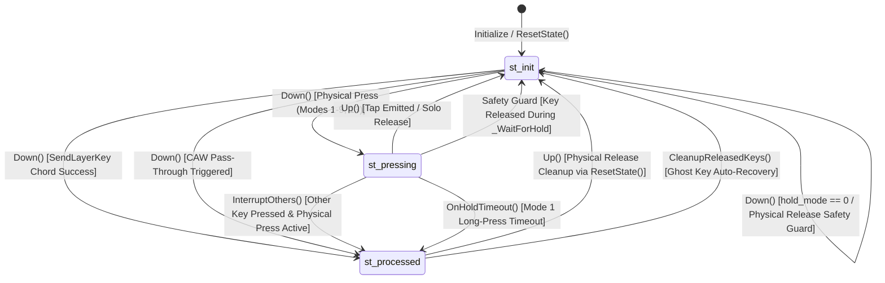

# Playgrounds Core Architecture & Hold Mode Analysis

# (PlayGroundsExp.ahk Code Analysis, Behavior Specification, and Mode Comparison Reference)

> **Note for AI Agents**:
> This document preserves the comprehensive domain analysis of `PlayGroundsExp.ahk`.
> Whenever designing, modifying, or refactoring code in this project, **refer to this document** to avoid redundant analysis and ensure 100% behavioral compatibility with established key state lifecycles and hold modes.

---

## 1. Classes, Functions, and Key State Variables

### 1.1 `ImeState` Class (`L169-L330`)

- **Role**: Manages and caches the IME (Input Method Editor) state (ON/OFF) and composition status using Win32 Imm APIs (`ImmGetContext`, `ImmGetOpenStatus`) or `WM_IME_CONTROL` (`SendMessageTimeout`).
- **Key Variables**:
  - `cached_state`: Boolean. The most recently fetched IME state.
  - `mode`: Integer (0: check if idle > threshold, 1: check if last check > threshold, 2: always check, 3: manual only).
  - `threshold`: Integer (ms, default 100). Cache validity window.
  - `last_active_control_hwnd`: HWND of the last focused control.
  - `force_ime_on`: Boolean flag to force IME state.

### 1.2 `RKey` Class (`L569-L703`)

- **Role**: Base class for remappable physical keys. Handles physical key name formatting (`org_key`, `org_key_raw`), IME ON/OFF mappings (`key_text`, `ime_key_text`), Shift variants (`shift_key_text`, `shift_ime_key_text`), and CAW (Ctrl/Alt/Win) pass-through.
- **Key Methods**:
  - `_SendCAWKey(pressed_key)`: Bypasses remapping and emits `{Blind}<key>` if Ctrl, Alt, or Win is physically held down.
  - `SendKeyWithShift()`: Determines physical Shift state (`IsPhysicalShiftPressed`) and dispatches the appropriate text.
  - `Down()` / `Up()`: Hotkey entry points.

### 1.3 `LKey` Class (`extends RKey`, `L932-L1215`)

- **Role**: Extends `RKey` with long-press (hold), tap-hold, center modifier, chord combinations, and asynchronous timer management.
- **Key State Variables**:
  - `state`:
    - `st_init` (0): Key is idle / released / unpressed.
    - `st_pressing` (1): Key is held down, awaiting tap-hold or combination evaluation.
    - `st_processed` (2): Key action or modifier has already been emitted / resolved. Prevents unwanted release actions in `Up()`.
  - `pressed_time_qpc`: Timestamp (ms, HighPrecisionTimer / QPC) when physical key press started.
  - `interrupted`: Boolean. Set to `true` when another key is struck while this key is in `st_pressing`.
  - `down_ime_state`: IME state captured at `Down()` invocation.
  - `down_hwnd`: Active window HWND captured at `Down()` invocation (used to prevent Cross-Window Backspace deletion).
  - `saved_scaw`: String of active modifier prefixes (Ctrl, Alt, Win, Shift) captured at `Down()` for Mode 3/13.
  - `timer_name`: BoundFunc for `-hold_th` timer (`OnHoldTimeout`).
- **Key Methods**:
  - `Down()`: Repeat-guarded press handler. Checks `SendLayerKey()`, CAW bypass, sets `st_pressing`, and handles mode-specific down actions.
  - `Up()`: Release handler. Stops timer, evaluates hold duration, executes Mode 3/5 tap actions if un-interrupted, and resets state to `st_init`.
  - `InterruptOthers(currentKey)`: Sets `interrupted := true`, stops timers, and transitions `state := st_processed` for all other `st_pressing` keys.
  - `OnHoldTimeout()`: Timer callback for Mode 1. Verifies focus (`down_hwnd`), emits `{Backspace}` and replacement character.

### 1.4 `Layers` Class (`L1405-L1899`)

- **Role**: Evaluates modifier states, layer mappings, combination chords, timing thresholds, and multi-stage tapping.
- **Key Variables**:
  - `hold_th`: Global default layer hold threshold (ms, default 200).
  - `b_time`: Global default rollover prevention buffer time (ms, default 50).
  - `b_time2`: Dedicated buffer time for Mode 8 (ms, default 50).
  - `last_active_item`: Reference to the last triggered `LayerItem` (for continuous tapping).
  - `arr` / `ime_arr`: Arrays of registered `LayerItem` mappings for IME OFF / ON.
- **Key Methods**:
  - `State(layer_id)` / `StateModKeyId(mod_key_id)`: Checks if a layer modifier is active. Supports dynamic layers (`layer_id > 8`).
  - `SendLayerKey(key_obj, ime_state)`: Main chord evaluation engine for Modes 5–9.
  - `_WaitForHold(mod_key, key_obj, hold_th)`: Polling wait function with interruption detection and message pump yielding (`Sleep(1)`).

### 1.5 Layer Array Binding & INI Specification (`Utils.ahk L1808-L2045`)

- **Role**: Manages 1-based 1D array `layer_id_to_mod_key_id` mapping `layer_id` (1–8 for predefined, 9+ for dynamic) to `mod_key_id` (M1–M8, M9+).
- **Fixed Mapping Contract**: Physical keys and detection logic for `M1`..`M8` are fixed in code (`Layers.StateModKeyId`). INI files store only `mod_key_id` (`M1`..`M8`, `none`) without redundant physical key names.
- **Reading Precedence (`LoadLayerBindingsFromIni`)**:
  1. `[LayerBinding]` section: Explicit binding (e.g., `NAVI_CTRL = M1`, `SELECT = none`).
  2. Layer section `ModKeyId` attribute: Local declaration inside `[<LayerName>]`.
  3. Legacy `[Settings]` section: `space = NAVI_CTRL` or `NAVI_CTRL = M1`.
  4. System default: `[1, 2, 3, 4, 5, 6, 7, 8]` fallback.
- **Writing Specification (`SaveLayerBindingsToIni`)**:
  - Iterates `layer_id` 1..Length in strict array order, emitting `"M" . mod_id` or `"none"` to `[LayerBinding]`.

---

## 2. Key Lifecycle Processing Flow

```mermaid
sequenceDiagram
    autonumber
    actor User as User Keyboard
    participant LKey as LKey (Down / Up)
    participant Layers as Layers (SendLayerKey)
    participant OS as OS / Send

    User->>LKey: Physical Key Press (Down)
    Note over LKey: 1. Repeat Guard: if state != st_init, return
    LKey->>Layers: 2. SendLayerKey(ime_state)
    alt Companion Modifier Key is Active (Chord Triggered)
        Layers->>OS: Send Layer Action
        LKey->>LKey: InterruptOthers(), state := st_processed
    else No Modifier or Chord Not Held
        Note over LKey: 3. CAW Pass-Through Check
        Note over LKey: 4. Physical Release Safety Guard (!IsPressed -> exit)
        Note over LKey: 5. Session Start: state := st_pressing, record QPC, down_hwnd, InterruptOthers()
        alt Mode 1
            LKey->>OS: Immediate Normal Send -> Start Timer (-hold_th)
        alt Mode 3 / 13 / 5
            Note over LKey: Suppress output on Down
        else Mode 4, 6, 7, 8, 9
            LKey->>OS: Immediate Normal Send
        end
    end

    User->>LKey: Physical Key Release (Up)
    Note over LKey: Stop Timer, calculate duration, reset to st_init
    alt Mode 3 / 13 (Tap Release)
        Note over LKey: duration < hold_th AND !interrupted -> Send Blind SCAW + Key
    else Mode 5 (Tap Release)
        Note over LKey: duration < hold_th AND !interrupted -> Send Normal Key
    end
```

---

## 3. Tap, Hold, and Continuous Tap Mechanics

### 3.1 Single Tap vs Single Hold

- **Mode 1**: Emits normal character on `Down()`. If held past `hold_th`, `OnHoldTimeout()` validates window focus (`down_hwnd`), sends `{Backspace}`, and emits the long-press replacement.
- **Mode 3 / 13 (Center Modifier)**: Emits nothing on `Down()`. On `Up()`, if `duration < hold_th` and `!interrupted`, sends normal character. If held past `hold_th` or combined with another key, acts purely as modifier.
- **Mode 5**: Emits nothing on `Down()`. On `Up()`, if `duration < hold_th` and `!interrupted`, sends normal character.

### 3.2 Continuous Tapping (Multi-stage Action)

- Evaluated in `Layers.SendLayerKey()`:
  - If `item.last_mod_key == mod_key && item.last_mod_press_start_qpc == mod_key.pressed_time_qpc && Layers.last_active_item == item`:
    - `item.tap_count += 1`
  - Else:
    - `item.tap_count := 1`
  - Action selection:
    - `tap_count >= 3 && action3 != ""`: emits `action3`
    - `tap_count >= 2 && action2 != ""`: emits `action2`
    - Else: emits `action1`

---

## 4. Comprehensive Mode Comparison (Modes 0 to 9)

### 4.1 Overview of Modes 0 to 4

- **Mode 0 (Normal Remap)**: Immediate send on `Down()`. Key repeat enabled. No hold detection.
- **Mode 1 (Tap Immediate, Hold Replace)**: Immediate send on `Down()`. Repeat disabled. Async timer replaces character via Backspace on timeout.
- **Mode 2 (Pure Modifier)**: No send on `Down()` or `Up()`. Used purely as layer switch.
- **Mode 3 / 13 (Center Modifier)**: Output deferred to `Up()`. If uncombined and released within threshold, sends normal key. Mode 13 includes pre-stroke buffer.
- **Mode 4 (Send on Down, Hold as Modifier)**: Immediate send on `Down()`. While held, functions simultaneously as a layer modifier for subsequent keys.

---

### 4.2 Deep Dive: Modes 5 to 9 (`Layers.SendLayerKey`)

#### Timing Parameters

- $t$: Elapsed time since modifier key A was pressed (`HighPrecisionTimer() - mod_key.pressed_time_qpc`)
- $x$: Hold threshold (`item.hold_th` or `Layers.hold_th`, typically 150–200ms)
- $b$: Rollover buffer time (`item.b_time` or `Layers.b_time` / `Layers.b_time2`, typically 50ms)

#### Time Zones

- **Zone 1 (Timeout / Hold)**: $t \ge x$
- **Zone 2 (Rollover / Fast Typing)**: $t < x - b$
- **Zone 3 (Gray Zone / Ambiguous)**: $x - b \le t < x$

#### Comparison Matrix

|    Mode    |     Down Action of A      |        Zone 1 ($t \ge x$)         |                                                                                             Zone 2 ($t < x - b$)                                                                                              |                                                                      Zone 3 ($x - b \le t < x$)                                                                      | Key Buffering & Output Behavior                                                                                                |
| :--------: | :-----------------------: | :-------------------------------: | :-----------------------------------------------------------------------------------------------------------------------------------------------------------------------------------------------------------: | :------------------------------------------------------------------------------------------------------------------------------------------------------------------: | :----------------------------------------------------------------------------------------------------------------------------- |
| **Mode 5** |  **Deferred** (No send)   | Chord Triggered (`is_held:=true`) |                                                          Chord Denied (`is_held:=false`).<br>**Emits A normal key** (`mod_key.SendKeyWithShift()`).                                                           |       Waits via `_WaitForHold`.<br>・Timeout (`res==3`): Chord Triggered.<br>・Early Release (`res==1,2`): Chord Denied $\rightarrow$ **Emits A normal key**.        | A is deferred on Down. If chord fails, A is immediately flushed, followed by B's normal Down.                                  |
| **Mode 6** | **Immediate Normal Send** | Chord Triggered (`is_held:=true`) |                                                                                             _(No Zone 2; $b=0$)_                                                                                              |                Entire range $0 \le t < x$ waits via `_WaitForHold`.<br>・Timeout (`res==3`): Chord Triggered.<br>・Release (`res!=3`): Chord Denied.                 | A is sent on Down. Threshold wait applies to all early strokes.                                                                |
| **Mode 7** | **Immediate Normal Send** | Chord Triggered (`is_held:=true`) |                                                              Chord Denied (`is_held:=false`).<br>No wait; B proceeds immediately to normal Down.                                                              |                          Waits via `_WaitForHold`.<br>・Timeout (`res==3`): Chord Triggered.<br>・Early Release (`res==1,2`): Chord Denied.                          | A is sent on Down. Fast typing in Zone 2 is resolved immediately without delay.                                                |
| **Mode 8** | **Immediate Normal Send** | Chord Triggered (`is_held:=true`) |                                                              Chord Denied (`is_held:=false`).<br>No wait; B proceeds immediately to normal Down.                                                              | Waits via `_WaitForHold`.<br>・Timeout (`res==3`): Chord Triggered.<br>・**B Released First (`res==2`): CHORD TRIGGERED!**<br>・A Released First (`res==1`): Denied. | Specialized for fast chord typing. Releasing companion key B before A in gray zone **triggers combination**. Uses `b_time2`.   |
| **Mode 9** | **Immediate Normal Send** | Chord Triggered (`is_held:=true`) | **Pre-sends B normal key**, then waits via `_WaitForHold`.<br>・Timeout (`res==3`): **Sends `{Backspace}` to erase B**, then Chord Triggered.<br>・Early Release (`res!=3`): Returns `true` (keeps normal B). |                           Waits via `_WaitForHold`.<br>・Timeout (`res==3`): Chord Triggered.<br>・Early Release (`res!=3`): Chord Denied.                           | Zone 2 pre-sends normal B to avoid latency. If user continues holding, cancels B via Backspace and replaces with chord action. |

---

## 5. IME State Management

1. **Acquisition & Caching**:
   - `ImeState.IsOn()` is called at the beginning of `LKey.Down()`.
   - In default mode (`mode == 0`), queries OS API (`ImmGetContext` / `WM_IME_CONTROL`) only if idle time exceeds `threshold` (100ms); otherwise returns `cached_state`.
2. **Session Preservation**:
   - `down_ime_state := ime_state` is saved on `LKey` instance during `Down()`.
3. **Usage**:
   - Determines layer mapping array (`arr` vs `ime_arr`).
   - Restores correct Shift/IME variant in `Up()` and `OnHoldTimeout()`.

---

## 6. State Machine & Interruption Transitions



### Invariant Conditions

1. If a key is physically released (`!this.IsPressed()`) and in `st_processed`, `CleanupReleasedKeys()` **resets it to `st_init`**, and `pressed_time_qpc` **is cleared to 0**.
2. If `state == st_processed`, `Up()` **MUST NOT** emit default tap actions.
3. If `interrupted == true`, timers are cancelled, `session_id` is incremented, and chord triggers are suppressed.
4. Each press session maintains a monotonic `session_id`. Stale asynchronous `OnHoldTimeout` callbacks with mismatched `timer_session_id != session_id` **MUST be discarded immediately**.

---

## 7. Discovered Issues & Root Causes

### 7.1 Confirmed Issues (Defects with Clear Specification Violations / Improper Behaviors)

1. **Uninitialized or Stale `key_obj.down_ime_state` Reference Issue in Mode 9 Zone 2**:
   - **Location**: `src/PlayGroundsExp.ahk` inside `Layers._EvaluateChord` (Line 1887)
   - **Symptom & Evidence**:
     ```ahk
     pre_text := (key_obj.down_ime_state == 1) ? key_obj.ime_key_text : key_obj.key_text
     bs_count := GetBackspaceUndoCount(pre_text)
     ```
     `SendLayerKey` is executed at the very beginning of `key_obj.Down()` (Line 1163). At this point, initialization of `key_obj` (the main key) itself (such as `this.down_ime_state := ime_state` or `this.pressed_time_qpc` at Line 1212) **has not been executed yet**.
     Consequently, `key_obj.down_ime_state` references either a stale value from a previous session or remains uninitialized (0).
     If the IME state toggles between the previous keystroke and the current one, `GetBackspaceUndoCount` calculates based on the incorrect key text (swapping `ime_key_text` and `key_text`), resulting in sending an incorrect count of Backspaces or failing to erase the pre-sent key.
     Since the latest correct `ime_state` is already passed as an argument to `SendLayerKey(key_obj, ime_state)`, passing `ime_state` to `_EvaluateChord` or referencing it via parameter is the direct fix.

2. **IME State Acquisition Inconsistency on Solo Mode 5 `Up()`**:
   - **Location**: `src/PlayGroundsExp.ahk` inside `LKey.Up()` (Line 1269)
   - **Symptom & Evidence**:
     At the start of `Up()` (Lines 1243-1245), `hold_mode` evaluation correctly respects `this.down_ime_state` saved at key press.
     However, `this.SendKeyWithShift()` called at Line 1269 accepts no parameters, causing internal resolution: `SendShiftedKey` -> `SendBasedOnImeState(..., ime_state := -1)`, which **re-fetches the real-time IME state at release time (`Up`)**.
     If the IME toggles between press and release, character output deviates from the user's intent at key press (`this.down_ime_state`).

---

### 7.2 Potential Issues (Risks Under Specific Timing or Input Sequence Conditions)

1. **Timer Callback & Delay Concerns Due to Over-extended `Critical` Scope**:
   - **Location**: `LKey.Down()`, `LKey.Up()`, `LKey.OnHoldTimeout()`
   - **Symptom & Evidence**:
     `LKey.Down()` temporarily turns `Critical "Off"` before `SendLayerKey()`, but re-applies `Critical` around `super._SendCAWKey` and `this.SendKeyWithShift()`.
     `OnHoldTimeout()` in particular keeps the entire function body under `Critical` (Line 1278).
     Dispatching keystrokes like `Send("{Backspace ...}")` or `this.SendShiftedKey(true, ...)` communicates directly with the OS. Blocking Windows message queues or low-level keyboard hooks during this period can trigger input lag or missed keystrokes during rapid typing.
     Restricting `Critical` strictly to shared state updates (`this.state := LKey.st_processed`, etc.) and executing `Critical "Off"` before dispatching external keys provides a safer thread model.

2. **Missing Validation for Invalid Mode Numbers or Time Thresholds in `config.ini` [RESOLVED]**:
   - **Location**: `src/Utils.ahk` inside `ResolveModKeyId`, `LoadLayerBindingsFromIni`, `HoldMode.__New`
   - **Status & Resolution**:
     `ResolveModKeyId` now strictly bounds `mod_key_id` to `1 <= mod_id <= max_mod_id` (rejecting unknown IDs like `M99999`).
     `LoadLayerBindingsFromIni` incorporates fallback handling to default layer bindings (`default_bindings[lay_id]`) or `0` for custom layers on invalid/unknown IDs.
     `HoldMode.__New` and `LayerItem.__New` enforce safe mode fallbacks (Mode 7).

3. **Incomplete Handling of IME Composition Strings During Backspace Undos**:
   - **Location**: `LKey.OnHoldTimeout()` (Mode 1), `Layers._EvaluateChord` (Mode 9)
   - **Symptom & Evidence**:
     `GetBackspaceUndoCount` calculates counts based on raw physical/logical character lengths (e.g., length 2 for "ka").
     When IME is active and composing Japanese text, typing "ka" converts dynamically into a single uncommitted character "か" (length 1).
     Emitting `Send("{Backspace 2}")` erases "か" and over-deletes an additional committed character preceding it.
     While `ImeState.is_composing_tracked` and `ImeState.composition_count` exist in code, composition character counts are not fully synchronized with Backspace undo counts.

---

### 7.3 Architectural & Maintainability Proposals

1. **Second Parameter of Helper Function `SetLayerImeKey2(layer_item, reset_if_blank := false)`**:
   - **Location**: `src/PlayGroundsExp.ahk` (Line 1126)
   - **Current State**:
     The second parameter `reset_if_blank` is currently unused inside the implementation (it is not forwarded to `this.layers.SetIMEAction2(layer_item)`).
     Analysis shows this parameter is retained for call-site backwards compatibility with older revisions, documented in JSDoc.
     The parameter definition should remain intact to prevent breaking external callers while ensuring internal safety defaults.

2. **State Variable Consistency & Lifecycle**:
   - `last_mod_key`, `last_mod_press_start_qpc`, `Layers.last_active_item`, `tap_count`:
     These track continuous tapping state for multi-stage actions (`action1`, `action2`, `action3`).
     Currently, `LKey.Down()` resets state via `Layers.last_active_item := ""` when a solo key is pressed.
     Explicitly clearing `Layers.last_active_item` during layer switches, `ResetCombinations()`, and `LKey.ResetAll()` will reinforce state consistency.

---

## 8. Prioritization & Migration Plan

| Priority | Issue / Task                             | Target File & Function                                 | Resolution                                                                                                            | Expected Benefit                                                                        | Impact on Existing Specification                                        |
| :------: | :--------------------------------------- | :----------------------------------------------------- | :-------------------------------------------------------------------------------------------------------------------- | :-------------------------------------------------------------------------------------- | :---------------------------------------------------------------------- |
|  **P1**  | Mode 9 IME State Synchronization         | `Layers.SendLayerKey`, `Layers._EvaluateChord`         | Add `ime_state` parameter to `_EvaluateChord` to eliminate uninitialized reads of `key_obj.down_ime_state`.           | Correct Backspace counts are dispatched in Mode 9 immediately after IME state switches. | Complete normalization of existing behavior (Zero side effects).        |
|  **P1**  | Mode 5 `Up()` IME State Synchronization  | `RKey.SendKeyWithShift`, `LKey.Up`                     | Add `ime_state := -1` parameter to `SendKeyWithShift`, passing `this.down_ime_state` from `LKey.Up`.                  | Prevents unintended character output caused by IME state toggles while holding a key.   | Complete normalization of existing behavior (100% backward compatible). |
|  **P1**  | Localize `Critical` Scope                | `LKey.OnHoldTimeout`, `LKey.Down`                      | Protect only shared state updates (`state`, `session_id`) with `Critical`, invoking `Critical "Off"` before `Send()`. | Reduces key loss and hook latency during fast typing.                                   | Key dispatch sequence and state protection strictly preserved.          |
|  **P2**  | `config.ini` Value Validation & Fallback | `Utils.ahk` (`ResolveModKeyId`, `LoadLayerBindings`), `HoldMode` | **[RESOLVED]** Added boundary validation for `mod_key_id` (1..max) and layer binding fallback to defaults; safe fallback for invalid IDs. | Prevents script crashes or undefined behaviors from configuration errors.               | Zero impact on valid configurations.                                    |
|  **P2**  | Layer Array INI Transition               | `Utils.ahk`, `readme.adoc`, `test_layer_mapping.ahk`   | **[RESOLVED]** Implemented `[LayerBinding]` section, strict array order preservation, and zero-redundancy fixed mapping. | Direct 1:1 synchronization between INI configuration and `layer_id_to_mod_key_id`.     | 100% backward compatible with `[Settings]`.                              |
|  **P2**  | Clear `last_active_item` on Layer Reset  | `PlayGroundsExp.ahk` (`ResetCombinations`, `ResetAll`) | Ensure `Layers.last_active_item := ""` is called reliably.                                                            | Prevents accidental multi-tap triggers right after layer switches.                      | Stabilizes multi-tap mechanics.                                         |
