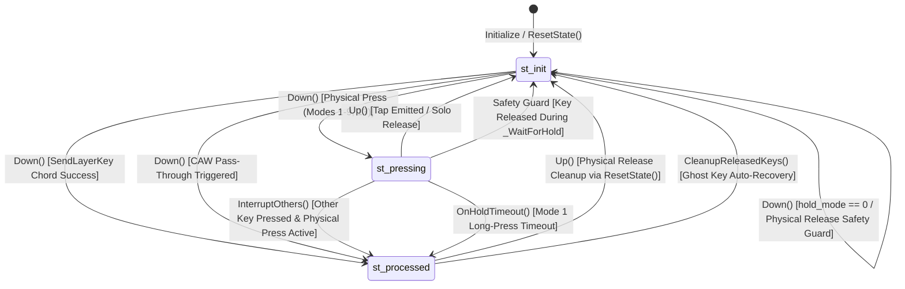

# Playgrounds Core Architecture & Hold Mode Analysis
# （PlayGroundsExp.ahk コード解析・動作仕様・モード比較リファレンス）

> **Note for AI Agents**:
> This document preserves the comprehensive domain analysis of `PlayGroundsExp.ahk`.
> Whenever designing, modifying, or refactoring code in this project, **refer to this document** to avoid redundant analysis and ensure 100% behavioral compatibility with established key state lifecycles and hold modes.

---

## 1. Classes, Functions, and Key State Variables / クラス・関数・主要変数の役割

### 1.1 `ImeState` Class (`L169-L330`)
- **Role**: Manages and caches the IME (Input Method Editor) state (ON/OFF) and composition status using Win32 Imm APIs (`ImmGetContext`, `ImmGetOpenStatus`) or `WM_IME_CONTROL` (`SendMessageTimeout`).
- **Key Variables**:
  - `cached_state`: Boolean. The most recently fetched IME state.
  - `mode`: Integer (0: check if idle > threshold, 1: check if last check > threshold, 2: always check, 3: manual only).
  - `threshold`: Integer (ms, default 100). Cache validity window.
  - `last_active_control_hwnd`: HWND of the last focused control.
  - `force_ime_on`: Boolean flag to force IME state.

### 1.2 `RKey` Class (`L569-L703`)
- **Role**: Base class for remappable physical keys. Handles physical key name formatting (`org_key`, `org_key_raw`), IME ON/OFF mappings (`key_text`, `ime_key_text`), Shift variants (`shift_key_text`, `shift_ime_key_text`), and CAW (Ctrl/Alt/Win) pass-through.
- **Key Methods**:
  - `_SendCAWKey(pressed_key)`: Bypasses remapping and emits `{Blind}<key>` if Ctrl, Alt, or Win is physically held down.
  - `SendKeyWithShift()`: Determines physical Shift state (`IsPhysicalShiftPressed`) and dispatches the appropriate text.
  - `Down()` / `Up()`: Hotkey entry points.

### 1.3 `LKey` Class (`extends RKey`, `L932-L1215`)
- **Role**: Extends `RKey` with long-press (hold), tap-hold, center modifier, chord combinations, and asynchronous timer management.
- **Key State Variables**:
  - `state`:
    - `st_init` (0): Key is idle / released / unpressed.
    - `st_pressing` (1): Key is held down, awaiting tap-hold or combination evaluation.
    - `st_processed` (2): Key action or modifier has already been emitted / resolved. Prevents unwanted release actions in `Up()`.
  - `pressed_time_qpc`: Timestamp (ms, HighPrecisionTimer / QPC) when physical key press started.
  - `interrupted`: Boolean. Set to `true` when another key is struck while this key is in `st_pressing`.
  - `down_ime_state`: IME state captured at `Down()` invocation.
  - `down_hwnd`: Active window HWND captured at `Down()` invocation (used to prevent Cross-Window Backspace deletion).
  - `saved_scaw`: String of active modifier prefixes (Ctrl, Alt, Win, Shift) captured at `Down()` for Mode 3/13.
  - `timer_name`: BoundFunc for `-hold_th` timer (`OnHoldTimeout`).
- **Key Methods**:
  - `Down()`: Repeat-guarded press handler. Checks `SendLayerKey()`, CAW bypass, sets `st_pressing`, and handles mode-specific down actions.
  - `Up()`: Release handler. Stops timer, evaluates hold duration, executes Mode 3/5 tap actions if un-interrupted, and resets state to `st_init`.
  - `InterruptOthers(currentKey)`: Sets `interrupted := true`, stops timers, and transitions `state := st_processed` for all other `st_pressing` keys.
  - `OnHoldTimeout()`: Timer callback for Mode 1. Verifies focus (`down_hwnd`), emits `{Backspace}` and replacement character.

### 1.4 `Layers` Class (`L1405-L1899`)
- **Role**: Evaluates modifier states, layer mappings, combination chords, timing thresholds, and multi-stage tapping.
- **Key Variables**:
  - `hold_th`: Global default layer hold threshold (ms, default 200).
  - `b_time`: Global default rollover prevention buffer time (ms, default 50).
  - `b_time2`: Dedicated buffer time for Mode 8 (ms, default 50).
  - `last_active_item`: Reference to the last triggered `LayerItem` (for continuous tapping).
  - `arr` / `ime_arr`: Arrays of registered `LayerItem` mappings for IME OFF / ON.
- **Key Methods**:
  - `State(layer_id)` / `StateModKeyId(mod_key_id)`: Checks if a layer modifier is active. Supports dynamic layers (`layer_id > 8`).
  - `SendLayerKey(key_obj, ime_state)`: Main chord evaluation engine for Modes 5–9.
  - `_WaitForHold(mod_key, key_obj, hold_th)`: Polling wait function with interruption detection and message pump yielding (`Sleep(1)`).

---

## 2. Key Lifecycle Processing Flow / 処理フロー

```mermaid
sequenceDiagram
    autonumber
    actor User as User Keyboard
    participant LKey as LKey (Down / Up)
    participant Layers as Layers (SendLayerKey)
    participant OS as OS / Send

    User->>LKey: Physical Key Press (Down)
    Note over LKey: 1. Repeat Guard: if state != st_init, return
    LKey->>Layers: 2. SendLayerKey(ime_state)
    alt Companion Modifier Key is Active (Chord Triggered)
        Layers->>OS: Send Layer Action
        LKey->>LKey: InterruptOthers(), state := st_processed
    else No Modifier or Chord Not Held
        Note over LKey: 3. CAW Pass-Through Check
        Note over LKey: 4. Physical Release Safety Guard (!IsPressed -> exit)
        Note over LKey: 5. Session Start: state := st_pressing, record QPC, down_hwnd, InterruptOthers()
        alt Mode 1
            LKey->>OS: Immediate Normal Send -> Start Timer (-hold_th)
        alt Mode 3 / 13 / 5
            Note over LKey: Suppress output on Down
        else Mode 4, 6, 7, 8, 9
            LKey->>OS: Immediate Normal Send
        end
    end

    User->>LKey: Physical Key Release (Up)
    Note over LKey: Stop Timer, calculate duration, reset to st_init
    alt Mode 3 / 13 (Tap Release)
        Note over LKey: duration < hold_th AND !interrupted -> Send Blind SCAW + Key
    else Mode 5 (Tap Release)
        Note over LKey: duration < hold_th AND !interrupted -> Send Normal Key
    end
```

---

## 3. Tap, Hold, and Continuous Tap Mechanics / 判定方式

### 3.1 Single Tap vs Single Hold
- **Mode 1**: Emits normal character on `Down()`. If held past `hold_th`, `OnHoldTimeout()` validates window focus (`down_hwnd`), sends `{Backspace}`, and emits the long-press replacement.
- **Mode 3 / 13 (Center Modifier)**: Emits nothing on `Down()`. On `Up()`, if `duration < hold_th` and `!interrupted`, sends normal character. If held past `hold_th` or combined with another key, acts purely as modifier.
- **Mode 5**: Emits nothing on `Down()`. On `Up()`, if `duration < hold_th` and `!interrupted`, sends normal character.

### 3.2 Continuous Tapping (Multi-stage Action)
- Evaluated in `Layers.SendLayerKey()`:
  - If `item.last_mod_key == mod_key && item.last_mod_press_start_qpc == mod_key.pressed_time_qpc && Layers.last_active_item == item`:
    - `item.tap_count += 1`
  - Else:
    - `item.tap_count := 1`
  - Action selection:
    - `tap_count >= 3 && action3 != ""`: emits `action3`
    - `tap_count >= 2 && action2 != ""`: emits `action2`
    - Else: emits `action1`

---

## 4. Comprehensive Mode Comparison (Modes 0 to 9) / モード詳細比較

### 4.1 Overview of Modes 0 to 4
- **Mode 0 (Normal Remap)**: Immediate send on `Down()`. Key repeat enabled. No hold detection.
- **Mode 1 (Tap Immediate, Hold Replace)**: Immediate send on `Down()`. Repeat disabled. Async timer replaces character via Backspace on timeout.
- **Mode 2 (Pure Modifier)**: No send on `Down()` or `Up()`. Used purely as layer switch.
- **Mode 3 / 13 (Center Modifier)**: Output deferred to `Up()`. If uncombined and released within threshold, sends normal key. Mode 13 includes pre-stroke buffer.
- **Mode 4 (Send on Down, Hold as Modifier)**: Immediate send on `Down()`. While held, functions simultaneously as a layer modifier for subsequent keys.

---

### 4.2 Deep Dive: Modes 5 to 9 (`Layers.SendLayerKey`)

#### Timing Parameters
- $t$: Elapsed time since modifier key A was pressed (`HighPrecisionTimer() - mod_key.pressed_time_qpc`)
- $x$: Hold threshold (`item.hold_th` or `Layers.hold_th`, typically 150–200ms)
- $b$: Rollover buffer time (`item.b_time` or `Layers.b_time` / `Layers.b_time2`, typically 50ms)

#### Time Zones
- **Zone 1 (Timeout / Hold)**: $t \ge x$
- **Zone 2 (Rollover / Fast Typing)**: $t < x - b$
- **Zone 3 (Gray Zone / Ambiguous)**: $x - b \le t < x$

#### Comparison Matrix

| Mode | Down Action of A | Zone 1 ($t \ge x$) | Zone 2 ($t < x - b$) | Zone 3 ($x - b \le t < x$) | Key Buffering & Output Behavior |
| :---: | :---: | :---: | :---: | :---: | :--- |
| **Mode 5** | **Deferred** (No send) | Chord Triggered (`is_held:=true`) | Chord Denied (`is_held:=false`).<br>**Emits A normal key** (`mod_key.SendKeyWithShift()`). | Waits via `_WaitForHold`.<br>・Timeout (`res==3`): Chord Triggered.<br>・Early Release (`res==1,2`): Chord Denied $\rightarrow$ **Emits A normal key**. | A is deferred on Down. If chord fails, A is immediately flushed, followed by B's normal Down. |
| **Mode 6** | **Immediate Normal Send** | Chord Triggered (`is_held:=true`) | *(No Zone 2; $b=0$)* | Entire range $0 \le t < x$ waits via `_WaitForHold`.<br>・Timeout (`res==3`): Chord Triggered.<br>・Release (`res!=3`): Chord Denied. | A is sent on Down. Threshold wait applies to all early strokes. |
| **Mode 7** | **Immediate Normal Send** | Chord Triggered (`is_held:=true`) | Chord Denied (`is_held:=false`).<br>No wait; B proceeds immediately to normal Down. | Waits via `_WaitForHold`.<br>・Timeout (`res==3`): Chord Triggered.<br>・Early Release (`res==1,2`): Chord Denied. | A is sent on Down. Fast typing in Zone 2 is resolved immediately without delay. |
| **Mode 8** | **Immediate Normal Send** | Chord Triggered (`is_held:=true`) | Chord Denied (`is_held:=false`).<br>No wait; B proceeds immediately to normal Down. | Waits via `_WaitForHold`.<br>・Timeout (`res==3`): Chord Triggered.<br>・**B Released First (`res==2`): CHORD TRIGGERED!**<br>・A Released First (`res==1`): Denied. | Specialized for fast chord typing. Releasing companion key B before A in gray zone **triggers combination**. Uses `b_time2`. |
| **Mode 9** | **Immediate Normal Send** | Chord Triggered (`is_held:=true`) | **Pre-sends B normal key**, then waits via `_WaitForHold`.<br>・Timeout (`res==3`): **Sends `{Backspace}` to erase B**, then Chord Triggered.<br>・Early Release (`res!=3`): Returns `true` (keeps normal B). | Waits via `_WaitForHold`.<br>・Timeout (`res==3`): Chord Triggered.<br>・Early Release (`res!=3`): Chord Denied. | Zone 2 pre-sends normal B to avoid latency. If user continues holding, cancels B via Backspace and replaces with chord action. |

---

## 5. IME State Management / IME 状態管理

1. **Acquisition & Caching**:
   - `ImeState.IsOn()` is called at the beginning of `LKey.Down()`.
   - In default mode (`mode == 0`), queries OS API (`ImmGetContext` / `WM_IME_CONTROL`) only if idle time exceeds `threshold` (100ms); otherwise returns `cached_state`.
2. **Session Preservation**:
   - `down_ime_state := ime_state` is saved on `LKey` instance during `Down()`.
3. **Usage**:
   - Determines layer mapping array (`arr` vs `ime_arr`).
   - Restores correct Shift/IME variant in `Up()` and `OnHoldTimeout()`.

---

## 6. State Machine & Interruption Transitions / 状態遷移



### Invariant Conditions
1. If a key is physically released (`!this.IsPressed()`) and in `st_processed`, `CleanupReleasedKeys()` **resets it to `st_init`**, and `pressed_time_qpc` **is cleared to 0**.
2. If `state == st_processed`, `Up()` **MUST NOT** emit default tap actions.
3. If `interrupted == true`, timers are cancelled, `session_id` is incremented, and chord triggers are suppressed.
4. Each press session maintains a monotonic `session_id`. Stale asynchronous `OnHoldTimeout` callbacks with mismatched `timer_session_id != session_id` **MUST be discarded immediately**.

---

## 7. Discovered Issues & Root Causes / 課題と原因分析

### 7.1 Confirmed Issues (Resolved)
1. **Key Release State Corruption in `LKey.Down()`**:
   - *Cause*: While `_WaitForHold` polled, releasing the key fired `LKey.Up()`, resetting to `st_init`. When `_WaitForHold` exited with `false`, `LKey.Down()` resumed and blindly set `state := st_pressing`. Because the key was already released, no subsequent `_Up()` ever fired, leaving the key permanently stuck in `st_pressing`.
   - *Fix*: Added physical release safety guard (`if !this.IsPressed()`) immediately after `SendLayerKey()` to clean up and exit.
2. **Interruption Leak in `_WaitForHold()`**:
   - *Cause*: `_WaitForHold()` loop only checked physical press and timeout, ignoring `mod_key.interrupted`. Third-key strikes failed to abort the wait loop.
   - *Fix*: Added `(mod_key.interrupted || mod_key.state != LKey.st_pressing)` check to immediately return `0` (interruption cancelled).
3. **`hold_mode == 0` Interruption Omission & Errant Space Insertion**:
   - *Cause*: In `LKey.Down()`, `if (hold_mode == 0)` exited immediately without calling `LKey.InterruptOthers(this)` or resetting `Layers.last_active_item`. Fast typing of normal characters while holding Space left Space un-interrupted, causing an unwanted trailing space on Space release.
   - *Fix*: Added `LKey.InterruptOthers(this)` and `this.ResetState()` to both `hold_mode == 0` and the `!this.IsPressed()` safety guard branch.
4. **Asynchronous Timer Race Across Sessions in Mode 1**:
   - *Cause*: `LKey` lacked session identification. Rapid consecutive presses could execute delayed `OnHoldTimeout()` callbacks from prior press sessions.
   - *Fix*: Introduced monotonic `session_id` and `timer_session_id`. Any callback where `timer_session_id != session_id` is discarded instantly.
5. **Ghost Key Press Deadlocks After Window Focus Loss**:
   - *Cause*: Alt-Tab or UAC focus transitions during physical key press caused the keyboard hook to lose the `Up` hotkey event, leaving the key in `st_processed` or `st_pressing`. Subsequent presses hit the repeat guard permanently.
   - *Fix*: Added `LKey.CleanupReleasedKeys()` and stale auto-repeat reset (`A_TimeSincePriorHotkey > 1500`).

### 7.2 Potential Issues & Latent Risks
1. **Mode 9 Multi-Character Backspace Incompleteness**:
   - *Risk*: Mode 9 sends `{Backspace}` once on timeout in Zone 2. If `key_obj` emitted a multi-character sequence or IME composition, a single Backspace leaves partial characters behind.


---

## 8. Clean Separation of Responsibilities / 責務分離設計

To refactor `Layers.SendLayerKey()` safely without changing external behavior:

1. **Responsibility 1: Parameter & Threshold Resolution**
   - Resolve `x := (item.hold_th >= 0) ? item.hold_th : Layers.hold_th`
   - Resolve `b := (item.b_time >= 0) ? item.b_time : ((mod_hold_mode == 8) ? Layers.b_time2 : Layers.b_time)`
   - Classify into `Zone 1` ($t \ge x$), `Zone 2` ($t < x - b$), or `Zone 3` (Gray Zone).
2. **Responsibility 2: Event Wait & Polling**
   - Perform `_WaitForHold()` only when Zone 3 (or Mode 9 Zone 2) is entered.
   - Return status: `0: Interrupted`, `1: Mod Released First`, `2: Main Released First`, `3: Timeout`.
3. **Responsibility 3: Mode-Specific Decision Matrix**
   - Pure decision logic mapping `(mode, zone, wait_result) -> is_held`.
4. **Responsibility 4: Mode-Specific Side Effects**
   - Mode 5 fallback send on chord denial.
   - Mode 9 Backspace cancellation.
5. **Responsibility 5: Key Dispatch & State Finalization**
   - Multi-stage continuous tap count update (`tap_count`).
   - `_SendKey()` execution and `mod_key.state := st_processed`.
