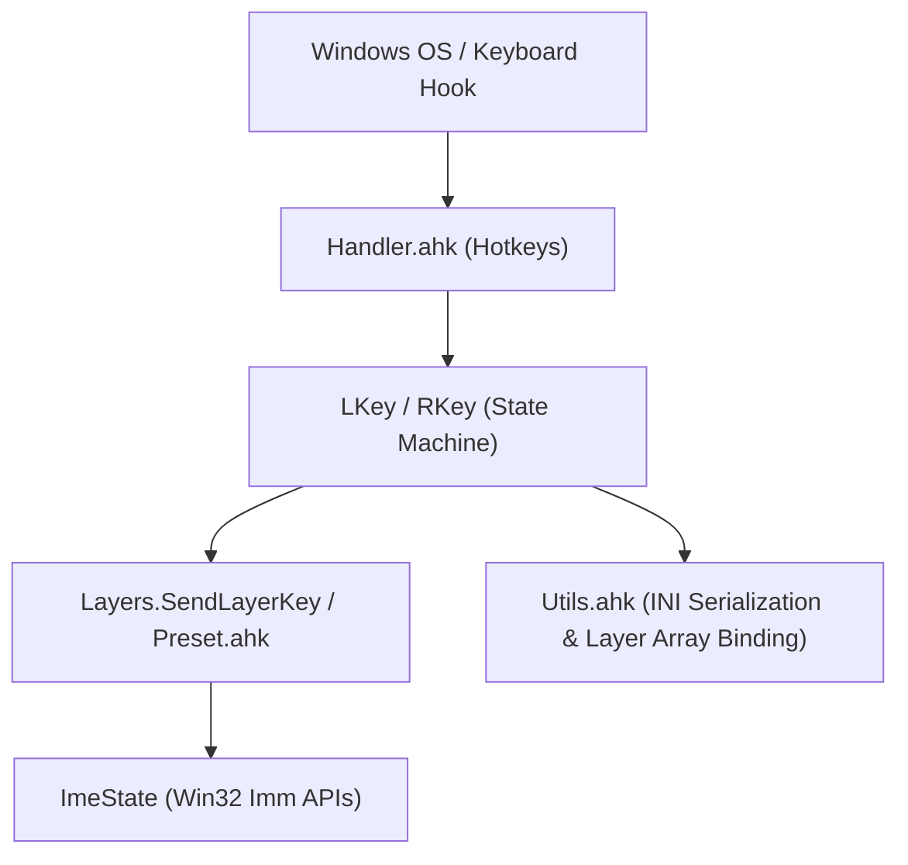

# Playgrounds Core Architecture & Hold Mode Analysis

# (PlayGroundsExp.ahk Code Analysis, Behavior Specification, and Mode Comparison Reference)

> **Note for AI Agents**:
> This document preserves the core domain analysis of `PlayGroundsExp.ahk`, `Preset.ahk`, `Utils.ahk`, and `Handler.ahk`.
> For the Web Config Editor UI (`src/ui/`), refer to [CODE_ANALYSIS_UI.md](CODE_ANALYSIS_UI.md).
> Key domain terms and coding rules are defined in [GLOSSARY.md](GLOSSARY.md).
> Before analyzing code from scratch, **refer to this document** to minimize reading cost and ensure 100% behavioral compatibility.

---

## 1. System Architecture & Cross-File Implementation



| File                     | Core Role & Architectural Responsibility                                                                            |
| :----------------------- | :------------------------------------------------------------------------------------------------------------------ |
| `src/PlayGroundsExp.ahk` | Entry point, high-resolution timer loop, core key state classes (`RKey`, `LKey`, `Layers`, `HoldMode`, `ImeState`). |
| `src/Handler.ahk`        | Hotkey intercepts via `#HotIf`, dispatching physical key down/up events to `Down()` and `Up()`.                     |
| `src/Preset.ahk`         | Built-in layout registrations and default layer mapping tables (`InitModLayer()`, `ChangeQwertyLayout()`, etc.).    |
| `src/Utils.ahk`          | INI file I/O (`[LayerBinding]` serialization), key/scancode resolution, font management, OSD alerts.                |

---

## 2. Core Classes & Key State Variables

### 2.1 `ImeState` Class

- **Role**: Manages and caches Windows IME (Input Method Editor) state (ON/OFF) and composition status via Win32 Imm APIs (`ImmGetContext`, `ImmGetOpenStatus`) or `WM_IME_CONTROL`.
- **Key Variables**:
  - `cached_state` (Bool): Last fetched IME state.
  - `threshold` (ms, default 100): Cache validity window.
  - `force_ime_on` (Bool): Force IME ON flag.
  - `last_active_control_hwnd` (HWND): Window/control handle of last focused element.

### 2.2 `RKey` Class (Base of Remappable Keys)

- **Role**: Base class for remappable physical keys (`org_key`, `org_key_raw`), logical keys (`key_text`, `ime_key_text`), Shift output (`shift_key_text`), and CAW (Ctrl/Alt/Win) bypass.
- **Key Methods**:
  - `_SendCAWKey(pressed_key)`: Bypasses remapping when Ctrl, Alt, or Win is held, sending `{Blind}<key>`.
  - `SendKeyWithShift(is_shift, ime_state)`: Sends key text according to physical Shift / SandS and IME state.

### 2.3 `LKey` Class (`extends RKey`)

- **Role**: Extends `RKey` with tap-hold, long-press, center modifier, chord evaluation, and asynchronous timer management.
- **State Machine (`state`)**:
  - `st_init` (0): Key is idle / released (離鍵状態).
  - `st_pressing` (1): Key is held down, awaiting tap-hold or chord resolution (押下判定中).
  - `st_processed` (2): Action or modifier emitted; prevents duplicate release actions in `Up()` (送信・処理済み).
- **Key Variables**:
  - `pressed_time_qpc`: HighPrecisionTimer timestamp (ms) when physical key press started.
  - `session_id`: Monotonic press generation ID to discard stale timer callbacks.
  - `interrupted` (Bool): Set to `true` when another key is struck while this key is in `st_pressing`.
  - `down_ime_state`: IME state captured at `Down()`.
  - `down_hwnd`: Active window HWND captured at `Down()`.
  - `timer_name`: BoundFunc for `-hold_th` timer (`OnHoldTimeout`).
- **Key Methods**:
  - `Down()`: Repeat-guarded press handler. Checks `SendLayerKey()`, CAW bypass, sets `st_pressing`.
  - `Up()`: Release handler. Cancels timer, checks duration, executes solo tap action, returns to `st_init`.
  - `InterruptOthers(currentKey)`: Flags `interrupted := true` and transitions other pressing keys to `st_processed`.
  - `OnHoldTimeout()`: Mode 1 timer callback (verifies focus, sends Backspace + Shifted key).

### 2.4 `Layers` Class

- **Role**: Manages layer activation, dynamic custom layers, Mode 5–9 chord evaluation, and multi-stage continuous tapping.
- **Key Variables**:
  - `hold_th` (ms, default 200): Global default layer hold threshold.
  - `b_time` (ms, default 50): Rollover prevention buffer window.
  - `b_time2` (ms, default 50): Dedicated buffer window for Mode 8.
  - `last_active_item`: Reference to last triggered `LayerItem` (for continuous tapping).
- **Key Methods**:
  - `State(layer_id)`: Checks if a layer modifier is active via `layer_id_to_mod_key_id`.
  - `SendLayerKey(key_obj, ime_state)`: Main chord evaluation engine for Modes 5–9.
  - `_WaitForHold(mod_key, key_obj, hold_th)`: Polling wait with interruption detection and `Sleep(1)` message pump yielding.

### 2.5 Layer Array Binding & INI Specification (`Utils.ahk`)

- **Structure**: 1D array `layer_id_to_mod_key_id := [M1, M2, M3, M4, M5, M6, M7, M8, ...]`.
- **Fixed Mapping (`Layers.StateModKeyId`)**:
  - `M1`: F13 (単独), `M2`: 無変換 (単独), `M3`: 変換 (単独), `M4`: F14 (単独), `M5`: F13+(Alt/無変換), `M6`: Tab, `M7`: Space (Space-Shift), `M8`: 変換+F14.
- **Loading Hierarchy (`LoadLayerBindingsFromIni`)**:
  1. `[LayerBinding]` section (highest priority: `NAVI_CTRL=M1`, `SELECT=none`, etc.).
  2. Legacy `[Settings]` section (backward compatibility).
  3. Default fallback: `[1, 2, 3, 4, 5, 6, 7, 8]`.

---

## 3. Key Lifecycle & State Machine Transitions

```
[st_init] (0)
   │
   │  Down() (first press)
   ▼
[st_pressing] (1) ── (Another key pressed: InterruptOthers) ──► [st_processed] (2)
   │                                                                 │
   │  Up() (duration < hold_th && !interrupted)                      │  Up()
   ▼                                                                 ▼
(Emit normal tap / Action) ──► [st_init] (0)                   (Do nothing) ──► [st_init] (0)
```

### Invariant Conditions

1. When a key is physically released (`!this.IsPressed()`), `CleanupReleasedKeys()` resets it to `st_init` and clears `pressed_time_qpc := 0`.
2. If `state == st_processed`, `Up()` **MUST NOT** emit default solo tap actions.
3. If `interrupted == true`, timers are cancelled, `session_id` is incremented, and subsequent actions are suppressed.
4. Outdated asynchronous timer callbacks with mismatched `timer_session_id != session_id` **MUST be discarded immediately**.

---

## 4. Hold Mode Decision Matrix (Modes 0 to 9)

| Mode  | Name (Japanese)                                     | Down Action                     | Up Action (< HoldTh)       | Hold Action (>= HoldTh)   | Rollover / Chord Behavior   |
| :---: | :-------------------------------------------------- | :------------------------------ | :------------------------- | :------------------------ | :-------------------------- |
| **0** | 標準リマップ (Normal Key)                           | Immediate send (repeat enabled) | None                       | None                      | Standard key typing         |
| **1** | 即時送信・長押し置換 (Immediate Send, Hold Replace) | Immediate normal send           | None                       | Backspace + Shifted key   | Timeout replacement         |
| **2** | 純粋修飾キー (Pure Modifier)                        | None                            | None                       | None                      | Layer modifier only         |
| **3** | 後判定修飾キー (Center Modifier / SandS)            | None                            | Solo normal tap send       | None (holds modifier)     | SandS or Space modifier     |
| **4** | モーダル修飾 (Send Down, Hold Modifier)             | Immediate normal send           | None                       | None                      | Dual-role typing            |
| **5** | 離鍵順序判定 (Deferred Send, Order Release)         | None                            | First released key action  | Later released key action | Zone 1 (`b_time`) delay     |
| **6** | 即時判定 (Immediate Evaluation)                     | None                            | Immediate chord action     | None                      | Zero buffer delay           |
| **7** | 両押下待機 (Tap-Hold with Rollover Buffer)          | None                            | Combined chord after delay | Solo long-press action    | Zone 2 (`b_time`) gray zone |
| **8** | 先行Up対応Tap-Hold (Preceding Up Chord)             | None                            | Trigger on companion Up    | Main modifier action      | Controlled by `b_time2`     |
| **9** | プレ送信・長押し置換 (Pre-send, BS Chord)           | Pre-sends companion key         | Confirms normal character  | Backspace + chord action  | Erases pre-sent key cleanly |

---

## 5. Architectural Invariants & Coding Guidelines

1. **IME State Synchronization**:
   - Explicitly pass `ime_state` to `SendLayerKey` / `_EvaluateChord`; never read uninitialized `key_obj.down_ime_state`.
   - In `LKey.Up()`, dispatch solo tap keys using `saved_down_ime_state` captured at press time.
2. **Critical Scope Minimization**:
   - Restrict `Critical` to atomic state mutations (`state`, `session_id`). Disengage `Critical "Off"` before OS `Send()`.
3. **Array Bounds & Safe Fallbacks**:
   - Validate `layer_id` and `mod_key_id` bounds (`1 <= id <= Length`); fall back safely to `0` or default array bindings on invalid input.
4. **Clean Variable Scopes (#Warn Compliance)**:
   - Explicitly initialize all local variables (e.g. `known_layers`) to prevent unassigned variable warnings under `#Warn`.
