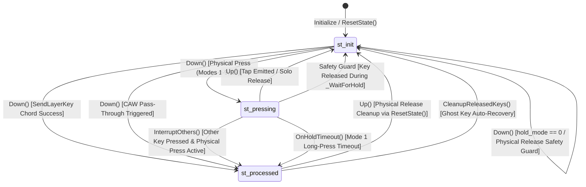

# Playgrounds Core Architecture & Hold Mode Analysis
# （PlayGroundsExp.ahk コード解析・動作仕様・モード比較リファレンス）

> **Note for AI Agents**:
> This document preserves the comprehensive domain analysis of `PlayGroundsExp.ahk`.
> Whenever designing, modifying, or refactoring code in this project, **refer to this document** to avoid redundant analysis and ensure 100% behavioral compatibility with established key state lifecycles and hold modes.

---

## 1. Classes, Functions, and Key State Variables / クラス・関数・主要変数の役割

### 1.1 `ImeState` Class (`L169-L330`)
- **Role**: Manages and caches the IME (Input Method Editor) state (ON/OFF) and composition status using Win32 Imm APIs (`ImmGetContext`, `ImmGetOpenStatus`) or `WM_IME_CONTROL` (`SendMessageTimeout`).
- **Key Variables**:
  - `cached_state`: Boolean. The most recently fetched IME state.
  - `mode`: Integer (0: check if idle > threshold, 1: check if last check > threshold, 2: always check, 3: manual only).
  - `threshold`: Integer (ms, default 100). Cache validity window.
  - `last_active_control_hwnd`: HWND of the last focused control.
  - `force_ime_on`: Boolean flag to force IME state.

### 1.2 `RKey` Class (`L569-L703`)
- **Role**: Base class for remappable physical keys. Handles physical key name formatting (`org_key`, `org_key_raw`), IME ON/OFF mappings (`key_text`, `ime_key_text`), Shift variants (`shift_key_text`, `shift_ime_key_text`), and CAW (Ctrl/Alt/Win) pass-through.
- **Key Methods**:
  - `_SendCAWKey(pressed_key)`: Bypasses remapping and emits `{Blind}<key>` if Ctrl, Alt, or Win is physically held down.
  - `SendKeyWithShift()`: Determines physical Shift state (`IsPhysicalShiftPressed`) and dispatches the appropriate text.
  - `Down()` / `Up()`: Hotkey entry points.

### 1.3 `LKey` Class (`extends RKey`, `L932-L1215`)
- **Role**: Extends `RKey` with long-press (hold), tap-hold, center modifier, chord combinations, and asynchronous timer management.
- **Key State Variables**:
  - `state`:
    - `st_init` (0): Key is idle / released / unpressed.
    - `st_pressing` (1): Key is held down, awaiting tap-hold or combination evaluation.
    - `st_processed` (2): Key action or modifier has already been emitted / resolved. Prevents unwanted release actions in `Up()`.
  - `pressed_time_qpc`: Timestamp (ms, HighPrecisionTimer / QPC) when physical key press started.
  - `interrupted`: Boolean. Set to `true` when another key is struck while this key is in `st_pressing`.
  - `down_ime_state`: IME state captured at `Down()` invocation.
  - `down_hwnd`: Active window HWND captured at `Down()` invocation (used to prevent Cross-Window Backspace deletion).
  - `saved_scaw`: String of active modifier prefixes (Ctrl, Alt, Win, Shift) captured at `Down()` for Mode 3/13.
  - `timer_name`: BoundFunc for `-hold_th` timer (`OnHoldTimeout`).
- **Key Methods**:
  - `Down()`: Repeat-guarded press handler. Checks `SendLayerKey()`, CAW bypass, sets `st_pressing`, and handles mode-specific down actions.
  - `Up()`: Release handler. Stops timer, evaluates hold duration, executes Mode 3/5 tap actions if un-interrupted, and resets state to `st_init`.
  - `InterruptOthers(currentKey)`: Sets `interrupted := true`, stops timers, and transitions `state := st_processed` for all other `st_pressing` keys.
  - `OnHoldTimeout()`: Timer callback for Mode 1. Verifies focus (`down_hwnd`), emits `{Backspace}` and replacement character.

### 1.4 `Layers` Class (`L1405-L1899`)
- **Role**: Evaluates modifier states, layer mappings, combination chords, timing thresholds, and multi-stage tapping.
- **Key Variables**:
  - `hold_th`: Global default layer hold threshold (ms, default 200).
  - `b_time`: Global default rollover prevention buffer time (ms, default 50).
  - `b_time2`: Dedicated buffer time for Mode 8 (ms, default 50).
  - `last_active_item`: Reference to the last triggered `LayerItem` (for continuous tapping).
  - `arr` / `ime_arr`: Arrays of registered `LayerItem` mappings for IME OFF / ON.
- **Key Methods**:
  - `State(layer_id)` / `StateModKeyId(mod_key_id)`: Checks if a layer modifier is active. Supports dynamic layers (`layer_id > 8`).
  - `SendLayerKey(key_obj, ime_state)`: Main chord evaluation engine for Modes 5–9.
  - `_WaitForHold(mod_key, key_obj, hold_th)`: Polling wait function with interruption detection and message pump yielding (`Sleep(1)`).

---

## 2. Key Lifecycle Processing Flow / 処理フロー

```mermaid
sequenceDiagram
    autonumber
    actor User as User Keyboard
    participant LKey as LKey (Down / Up)
    participant Layers as Layers (SendLayerKey)
    participant OS as OS / Send

    User->>LKey: Physical Key Press (Down)
    Note over LKey: 1. Repeat Guard: if state != st_init, return
    LKey->>Layers: 2. SendLayerKey(ime_state)
    alt Companion Modifier Key is Active (Chord Triggered)
        Layers->>OS: Send Layer Action
        LKey->>LKey: InterruptOthers(), state := st_processed
    else No Modifier or Chord Not Held
        Note over LKey: 3. CAW Pass-Through Check
        Note over LKey: 4. Physical Release Safety Guard (!IsPressed -> exit)
        Note over LKey: 5. Session Start: state := st_pressing, record QPC, down_hwnd, InterruptOthers()
        alt Mode 1
            LKey->>OS: Immediate Normal Send -> Start Timer (-hold_th)
        alt Mode 3 / 13 / 5
            Note over LKey: Suppress output on Down
        else Mode 4, 6, 7, 8, 9
            LKey->>OS: Immediate Normal Send
        end
    end

    User->>LKey: Physical Key Release (Up)
    Note over LKey: Stop Timer, calculate duration, reset to st_init
    alt Mode 3 / 13 (Tap Release)
        Note over LKey: duration < hold_th AND !interrupted -> Send Blind SCAW + Key
    else Mode 5 (Tap Release)
        Note over LKey: duration < hold_th AND !interrupted -> Send Normal Key
    end
```

---

## 3. Tap, Hold, and Continuous Tap Mechanics / 判定方式

### 3.1 Single Tap vs Single Hold
- **Mode 1**: Emits normal character on `Down()`. If held past `hold_th`, `OnHoldTimeout()` validates window focus (`down_hwnd`), sends `{Backspace}`, and emits the long-press replacement.
- **Mode 3 / 13 (Center Modifier)**: Emits nothing on `Down()`. On `Up()`, if `duration < hold_th` and `!interrupted`, sends normal character. If held past `hold_th` or combined with another key, acts purely as modifier.
- **Mode 5**: Emits nothing on `Down()`. On `Up()`, if `duration < hold_th` and `!interrupted`, sends normal character.

### 3.2 Continuous Tapping (Multi-stage Action)
- Evaluated in `Layers.SendLayerKey()`:
  - If `item.last_mod_key == mod_key && item.last_mod_press_start_qpc == mod_key.pressed_time_qpc && Layers.last_active_item == item`:
    - `item.tap_count += 1`
  - Else:
    - `item.tap_count := 1`
  - Action selection:
    - `tap_count >= 3 && action3 != ""`: emits `action3`
    - `tap_count >= 2 && action2 != ""`: emits `action2`
    - Else: emits `action1`

---

## 4. Comprehensive Mode Comparison (Modes 0 to 9) / モード詳細比較

### 4.1 Overview of Modes 0 to 4
- **Mode 0 (Normal Remap)**: Immediate send on `Down()`. Key repeat enabled. No hold detection.
- **Mode 1 (Tap Immediate, Hold Replace)**: Immediate send on `Down()`. Repeat disabled. Async timer replaces character via Backspace on timeout.
- **Mode 2 (Pure Modifier)**: No send on `Down()` or `Up()`. Used purely as layer switch.
- **Mode 3 / 13 (Center Modifier)**: Output deferred to `Up()`. If uncombined and released within threshold, sends normal key. Mode 13 includes pre-stroke buffer.
- **Mode 4 (Send on Down, Hold as Modifier)**: Immediate send on `Down()`. While held, functions simultaneously as a layer modifier for subsequent keys.

---

### 4.2 Deep Dive: Modes 5 to 9 (`Layers.SendLayerKey`)

#### Timing Parameters
- $t$: Elapsed time since modifier key A was pressed (`HighPrecisionTimer() - mod_key.pressed_time_qpc`)
- $x$: Hold threshold (`item.hold_th` or `Layers.hold_th`, typically 150–200ms)
- $b$: Rollover buffer time (`item.b_time` or `Layers.b_time` / `Layers.b_time2`, typically 50ms)

#### Time Zones
- **Zone 1 (Timeout / Hold)**: $t \ge x$
- **Zone 2 (Rollover / Fast Typing)**: $t < x - b$
- **Zone 3 (Gray Zone / Ambiguous)**: $x - b \le t < x$

#### Comparison Matrix

| Mode | Down Action of A | Zone 1 ($t \ge x$) | Zone 2 ($t < x - b$) | Zone 3 ($x - b \le t < x$) | Key Buffering & Output Behavior |
| :---: | :---: | :---: | :---: | :---: | :--- |
| **Mode 5** | **Deferred** (No send) | Chord Triggered (`is_held:=true`) | Chord Denied (`is_held:=false`).<br>**Emits A normal key** (`mod_key.SendKeyWithShift()`). | Waits via `_WaitForHold`.<br>・Timeout (`res==3`): Chord Triggered.<br>・Early Release (`res==1,2`): Chord Denied $\rightarrow$ **Emits A normal key**. | A is deferred on Down. If chord fails, A is immediately flushed, followed by B's normal Down. |
| **Mode 6** | **Immediate Normal Send** | Chord Triggered (`is_held:=true`) | *(No Zone 2; $b=0$)* | Entire range $0 \le t < x$ waits via `_WaitForHold`.<br>・Timeout (`res==3`): Chord Triggered.<br>・Release (`res!=3`): Chord Denied. | A is sent on Down. Threshold wait applies to all early strokes. |
| **Mode 7** | **Immediate Normal Send** | Chord Triggered (`is_held:=true`) | Chord Denied (`is_held:=false`).<br>No wait; B proceeds immediately to normal Down. | Waits via `_WaitForHold`.<br>・Timeout (`res==3`): Chord Triggered.<br>・Early Release (`res==1,2`): Chord Denied. | A is sent on Down. Fast typing in Zone 2 is resolved immediately without delay. |
| **Mode 8** | **Immediate Normal Send** | Chord Triggered (`is_held:=true`) | Chord Denied (`is_held:=false`).<br>No wait; B proceeds immediately to normal Down. | Waits via `_WaitForHold`.<br>・Timeout (`res==3`): Chord Triggered.<br>・**B Released First (`res==2`): CHORD TRIGGERED!**<br>・A Released First (`res==1`): Denied. | Specialized for fast chord typing. Releasing companion key B before A in gray zone **triggers combination**. Uses `b_time2`. |
| **Mode 9** | **Immediate Normal Send** | Chord Triggered (`is_held:=true`) | **Pre-sends B normal key**, then waits via `_WaitForHold`.<br>・Timeout (`res==3`): **Sends `{Backspace}` to erase B**, then Chord Triggered.<br>・Early Release (`res!=3`): Returns `true` (keeps normal B). | Waits via `_WaitForHold`.<br>・Timeout (`res==3`): Chord Triggered.<br>・Early Release (`res!=3`): Chord Denied. | Zone 2 pre-sends normal B to avoid latency. If user continues holding, cancels B via Backspace and replaces with chord action. |

---

## 5. IME State Management / IME 状態管理

1. **Acquisition & Caching**:
   - `ImeState.IsOn()` is called at the beginning of `LKey.Down()`.
   - In default mode (`mode == 0`), queries OS API (`ImmGetContext` / `WM_IME_CONTROL`) only if idle time exceeds `threshold` (100ms); otherwise returns `cached_state`.
2. **Session Preservation**:
   - `down_ime_state := ime_state` is saved on `LKey` instance during `Down()`.
3. **Usage**:
   - Determines layer mapping array (`arr` vs `ime_arr`).
   - Restores correct Shift/IME variant in `Up()` and `OnHoldTimeout()`.

---

## 6. State Machine & Interruption Transitions / 状態遷移



### Invariant Conditions
1. If a key is physically released (`!this.IsPressed()`) and in `st_processed`, `CleanupReleasedKeys()` **resets it to `st_init`**, and `pressed_time_qpc` **is cleared to 0**.
2. If `state == st_processed`, `Up()` **MUST NOT** emit default tap actions.
3. If `interrupted == true`, timers are cancelled, `session_id` is incremented, and chord triggers are suppressed.
4. Each press session maintains a monotonic `session_id`. Stale asynchronous `OnHoldTimeout` callbacks with mismatched `timer_session_id != session_id` **MUST be discarded immediately**.

---

## 7. Discovered Issues & Root Causes / 課題と原因分析

### 7.1 確認済みの問題 (Confirmed Issues: 仕様違反・不正動作が明確なもの)

1. **Mode 9 Zone 2 における `key_obj.down_ime_state` 未設定・古い状態の参照不具合**:
   - **箇所**: `src/PlayGroundsExp.ahk` 内 `Layers._EvaluateChord` (Line 1887)
   - **現象と根拠**:
     ```ahk
     pre_text := (key_obj.down_ime_state == 1) ? key_obj.ime_key_text : key_obj.key_text
     bs_count := GetBackspaceUndoCount(pre_text)
     ```
     `SendLayerKey` は `key_obj.Down()` の最初期（Line 1163）に実行される。この段階では `key_obj`（メインキー）自身の押下初期化処理（Line 1212 の `this.down_ime_state := ime_state` や `this.pressed_time_qpc`）は**まだ実行されていない**。
     そのため、`key_obj.down_ime_state` は前回のセッションの古い値、あるいは未初期化（0）のまま参照される。
     もし直前の打鍵と現在の打鍵の間で IME 状態が切り替わっていた場合、誤ったキーテキスト（`ime_key_text` と `key_text` の逆）に基づいて `GetBackspaceUndoCount` が計算され、誤った文字数の Backspace が送信されるか、消去に失敗する。
     なお、`SendLayerKey(key_obj, ime_state)` の引数には最新の正しい `ime_state` が渡されているため、`_EvaluateChord` に `ime_state` を渡すか、引数経由で参照するのが直接の解決策である。

2. **Mode 5 単独 Up 時における IME 状態の取得不整合**:
   - **箇所**: `src/PlayGroundsExp.ahk` 内 `LKey.Up()` (Line 1269)
   - **現象と根拠**:
     `Up()` の冒頭（Line 1243-1245）では、`hold_mode` の判定において「押下時に保存した `this.down_ime_state`」を正しく尊重している。
     しかし、Line 1269 でキーを送信する `this.SendKeyWithShift()` は引数を取らないため、内部で `SendShiftedKey` -> `SendBasedOnImeState(..., ime_state := -1)` となり、**キー解放時点（Up時）のリアルタイムな IME 状態**を再取得して送信してしまう。
     キーを押してから離すまでの間に IME のオン・オフが切り替わった場合、押下時の意図（`this.down_ime_state`）と異なるレイアウト文字が送信されてしまう。

---

### 7.2 潜在的な問題 (Potential Issues: 特定のタイミングや入力順序で発生するリスク)

1. **`Critical` の適用範囲によるタイマーコールバック・入力遅延の懸念**:
   - **箇所**: `LKey.Down()`, `LKey.Up()`, `LKey.OnHoldTimeout()`
   - **現象と根拠**:
     `LKey.Down()` では `SendLayerKey()` の前に一時的に `Critical "Off"` しているが、その後の `super._SendCAWKey` や `this.SendKeyWithShift()` の前後で `Critical` が適用されている。
     特に `OnHoldTimeout()` では、関数全体が `Critical` になっている（Line 1278）。
     `Send("{Backspace ...}")` や `this.SendShiftedKey(true, ...)` は OS へのキーストローク送信を伴うが、この間 Windows のスレッドメッセージキューや低レベルキーボードフックがブロックされると、高速打鍵時の次のキー入力の取りこぼしや遅延の原因になり得る。
     必要な共有状態の更新（`this.state := LKey.st_processed` 等）のみを `Critical` で保護し、外部キー送信時は `Critical "Off"` にするのがより安全である。

2. **`config.ini` における不正なモード番号・時間閾値の検証欠落**:
   - **箇所**: `src/Utils.ahk` の `LoadLayoutConfig` (Line 1631-1644) および `HoldMode.__New`
   - **現象と根拠**:
     `config.ini` で `m_s_f = 99, action1` のように存在しないモード番号や、`hold_th = -10` などの負値が記述されていた場合、検証が行われずそのまま格納される。
     `Layers.SendLayerKey` では `chord_result := (mod_hold_mode >= 5 && mod_hold_mode <= 9) ? ... : (t_qpc >= x ? 1 : 0)` と判定されるため、未知のモードの場合は未定義のフォールバック動作（単に `t_qpc >= x`）になり、意図しない挙動になる。
     モード番号の範囲検証（0〜13）と時間閾値の非負検証を導入し、不正値の場合は安全なデフォルト（Mode 7, Layers.hold_th）にフォールバックすべきである。

3. **Backspace 取消しにおける IME 未確定文字列（Composition）の考慮**:
   - **箇所**: `LKey.OnHoldTimeout()` (Mode 1), `Layers._EvaluateChord` (Mode 9)
   - **現象と根拠**:
     `GetBackspaceUndoCount` は入力された物理/論理文字数（例えば "ka" なら 2）を返す。
     しかし、IME が ON で日本語入力中（未確定文字列が存在する状態）の場合、ローマ字 "ka" は IME 内部で "か"（1文字）に変換されている。
     ここで `Send("{Backspace 2}")` を送信すると、"か" を消去した上でさらにその前の確定文字まで消去してしまう（過剰削除）。
     現在 `ImeState.is_composing_tracked` や `ImeState.composition_count` という変数が存在するが、未確定文字の文字数と Backspace 数が完全には連動していない。

---

### 7.3 設計上の改善案 (Architectural & Maintainability Proposals)

1. **補助関数 `SetLayerImeKey2(layer_item, reset_if_blank := false)` の第2引数**:
   - **箇所**: `src/PlayGroundsExp.ahk` (Line 1126)
   - **現状**:
     第2引数 `reset_if_blank` は現在内部で一切使用されていない（`this.layers.SetIMEAction2(layer_item)` に渡されていない）。
     調査の結果、古いリビジョンとの呼び出し互換性のため JSDoc で「後方互換性保持用パラメータ」として明記されている。
     外部からの呼び出し元を破壊しないため引数定義自体は維持しつつ、安全なデフォルト挙動を担保する。

2. **状態変数の整合性とライフサイクル**:
   - `last_mod_key`, `last_mod_press_start_qpc`, `Layers.last_active_item`, `tap_count`:
     これらは連続打鍵（Multi-stage Action: `action1`, `action2`, `action3`）を判定するための変数である。
     現在、`LKey.Down()` において `Layers.last_active_item := ""` が実行され、単独キーが押された際にはリセットされるようになっている。
     レイヤー切り替え時および `ResetCombinations()`、`LKey.ResetAll()` 時に `Layers.last_active_item` を確実にクリアする処理を追加し、状態の一貫性をさらに高める。

---

## 8. 改善の優先順位と既存動作への影響 (Prioritization & Migration Plan)

| 優先度 | 課題項目 | 対象ファイル・関数 | 修正内容 | 期待効果 | 既存仕様への影響 |
| :---: | :--- | :--- | :--- | :--- | :--- |
| **P1** | Mode 9 の IME 状態同期 | `Layers.SendLayerKey`, `Layers._EvaluateChord` | `_EvaluateChord` の引数に `ime_state` を追加し、`key_obj.down_ime_state` の未初期化参照を解消 | IME 切替直後の Mode 9 で正しい文字数の Backspace が送信される | 既存仕様の完全な正常化（副作用なし） |
| **P1** | Mode 5 Up 時の IME 状態同期 | `RKey.SendKeyWithShift`, `LKey.Up` | `SendKeyWithShift(ime_state := -1)` に引数を追加し、`LKey.Up` から `this.down_ime_state` を渡す | キー長押し中の IME 切替による意図しない解放文字化を防止 | 既存仕様の完全な正常化（後方互換性 100% 維持） |
| **P1** | `Critical` 適用範囲の局所化 | `LKey.OnHoldTimeout`, `LKey.Down` | 共有状態更新（state, session_id）のみを Critical で保護し、`Send()` の前に `Critical "Off"` | 高速打鍵時のキー取りこぼしとフック遅延を低減 | キー送信順序および状態保護は完全維持 |
| **P2** | `config.ini` 設定値の検証とフォールバック | `Utils.ahk` (`LoadLayoutConfig`), `HoldMode` | モード番号（0〜13）、hold_th、b_time の境界値検証を追加し、無効値は安全なデフォルト値へ置換 | 設定ミスやファイル破損によるスクリプト停止・未定義動作を防止 | 正常な設定値には影響ゼロ |
| **P2** | レイヤーリセット時の `last_active_item` クリア | `PlayGroundsExp.ahk` (`ResetCombinations`, `ResetAll`) | `Layers.last_active_item := ""` を確実に呼び出す | レイヤー切り替え直後の意図しない連打アクション誤爆を防止 | 連打仕様の安定化 |
