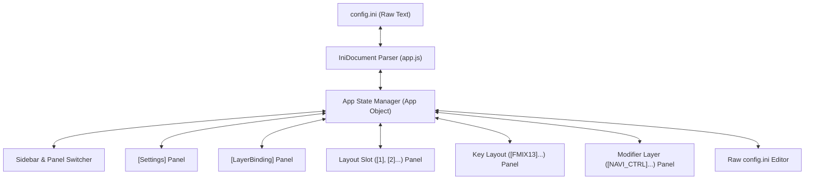

# Playgrounds Web Config Editor UI Architecture & Code Analysis

> **Note for AI Agents**:
> This document provides the architecture and cross-file analysis of the Key Layout Config Editor Web UI (`src/ui/`).
> For AHK core logic, refer to [CODE_ANALYSIS.md](CODE_ANALYSIS.md).
> Key domain terms and coding rules are defined in [GLOSSARY.md](GLOSSARY.md).

---

## 1. UI Overview & System Architecture
The Key Layout Config Editor is a single-page application (SPA) built with Vanilla HTML/CSS/JavaScript located under `src/ui/`.
It directly reads, edits, and saves `config.ini` via the browser's File System Access API (persisting file handles in IndexedDB) or external AHK file launchers.

---

## 2. File Organization & Cross-File Implementation

| File | Lines (approx.) | Role & Core Responsibility |
| :--- | :--- | :--- |
| `src/ui/index.html` | ~650 lines | UI DOM structure, sidebar navigation, 6 content panels, modals for adding/editing slots, layers, and chords. |
| `src/ui/app.js` | ~2,250 lines | INI parser (`IniDocument`), DOM event handlers, validation logic, state synchronization, and file persistence. |
| `src/ui/style.css` | ~1,000 lines | Dark-theme styling, compact virtual keyboard layout, modal overlays, responsive utility classes. |
| `src/PlayGroundsExp.ahk` | `OpenConfigEditor()` | Launch helper opening `src/ui/index.html` in default browser via AHK tray menu or shortcuts (`#p`). |

---

## 3. Core Classes & Data Flow

### 3.1 `IniDocument` Class (`app.js L4-L188`)
An AST-like parser that manipulates INI files while preserving whole-line comments, blank lines, section order, indentation, and inline comments (` ;` or `\t;`).

- **Line Object Types (`type`)**:
  - `section`: `[SectionName]` (stores `name`, `comment`, `raw`).
  - `keyvalue`: `key = value ; inline comment` (stores `section`, `key`, `value`, `inlineComment`, `raw`).
  - `comment`: `; full-line comment`.
  - `empty`: Blank lines.
- **Key Methods**:
  - `parse(text)`: Parses raw text into line objects array `this.lines`.
  - `toString()`: Serializes `this.lines` back to INI string while preserving formatting.
  - `getValue(section, key, defaultValue)`: Retrieves value with case-insensitive matching; normalizes semicolon character `{sc027}` $\leftrightarrow$ `;`.
  - `setValue(section, key, value)`: Updates existing line or appends to target section (creates section if missing).
  - `deleteKey(section, key)` / `deleteSection(section)`: Removes keys/sections.
  - `renameSection(oldName, newName)`: Updates section header and all child lines.

### 3.2 `App` Object (`app.js L390+`)
Coordinates UI lifecycle, panel routing, DOM data binding, and modification state tracking.

- **State Variables**:
  - `currentPanel`: Active panel ID (`panel-settings`, `panel-dynamic-layers`, `panel-slot`, `panel-layout`, `panel-layer`, `panel-raw`).
  - `activeLayoutSlot`: Selected numbered slot string (e.g. `"1"`, `"2"`).
  - `activeLayoutSec`: Selected layout section name (e.g. `"FMIX13"`).
  - `activeLayerName`: Selected modifier layer section name (e.g. `"NAVI_CTRL"`).
  - `isModified`: Unsaved dirty state flag (appends `*` to title, warns before unload).

---

## 4. Panel Specifications & INI Section Mapping

### 4.1 General Settings (`[Settings]`)
- **Parameters**: `StartupLayout`, `HoldTh`, `LayerHoldTh`, `b_time`, `b_time2`, `ImeIndicatorEnabled`, `LogEnabled`, `MaxLog`.
- **Behavior**: Input/change events immediately execute `this.doc.setValue('Settings', key, val)`.

### 4.2 Layer Array Binding (`[LayerBinding]`)
- **Role**: Replaces legacy physical key mapping (`space=NAVI_CTRL`). Manages binding between layer names (standard `NAVI_CTRL`, `SYMBOL_NUM`, `SYMBOL1`, `SYMBOL2`, `SELECT`, `NUMPAD`, `SHIFT`, `FUNC`, plus custom layers) and modifier key IDs (`M1`–`M8`, `none`).
- **UI Table Structure**:
  - `レイヤー名 / ID` (Layer Name / ID)
  - `修飾キーID (バインド先)` (Modifier Key ID dropdown: `none`, `M1`–`M8`)
  - `修飾キーの説明` (Modifier Description preview: e.g., `M1: F13 (単独)`, `M2: 無変換 (単独)`, `M7: Space (Space-Shift)`)
  - `操作` (Actions: jump to layer editor, or create section if not yet created).
- **Behavior**: Sets `LayerBinding` section directly (`this.doc.setValue('LayerBinding', layerName, modId)`). Does not pollute `[Settings]`.

### 4.3 Layout Slots (`[1]`, `[2]`...)
- **Parameters**: `ver=2`, `Name`, `Layout` (IME OFF layout section), `LayoutIME` (IME ON layout section).
- **Behavior**: Creates sequential numbered sections for switchable slots.

### 4.4 Key Layout Definitions (`[<LayoutName>]`)
- **Parameters**: `Mode`, `L00`–`L03` (Standard JIS 4-row layout), `S00`–`S03` (Shifted layout), `m_x+y` (Chording/combination definitions).
- **Features**: Visual keyboard grid allowing click-to-edit for characters and `{Left}`, `{Enter}` macros.

### 4.5 Modifier Layers (`[<LayerName>]`)
- **Parameters**: `<physical_key> = <send_action>` (single or multi-stage pipe-delimited actions `action1|action2`).
- **Synchronization Invariants**:
  - Renaming layer: Calls `this.doc.renameSection()` and updates corresponding key in `[LayerBinding]`.
  - Deleting layer: Calls `this.doc.deleteSection()` and deletes corresponding key in `[LayerBinding]`.

---

## 5. Storage & Persistence Flow
1. **File System Access API (Primary)**:
   - Uses `showOpenFilePicker()` to obtain file handle for `config.ini`, storing handle in IndexedDB (`KeyLayoutConfigEditorDB`).
   - Writes directly to disk upon clicking "変更を config.ini に保存" (Save to config.ini).
2. **Fallback**:
   - For environments lacking File System Access API, triggers direct browser file download or allows manual clipboard copy via the Raw text panel.
