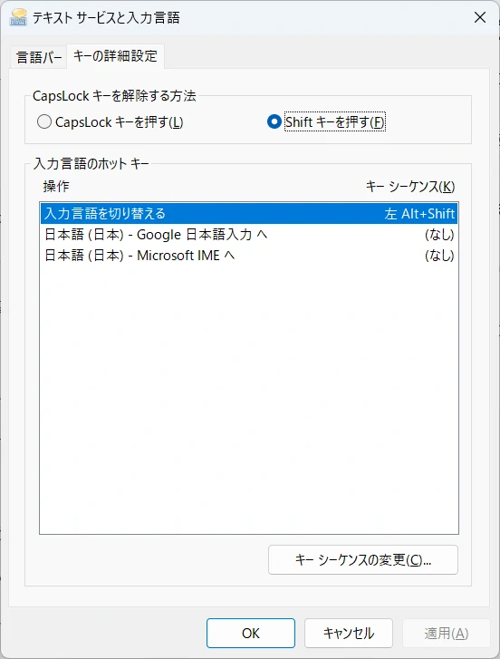
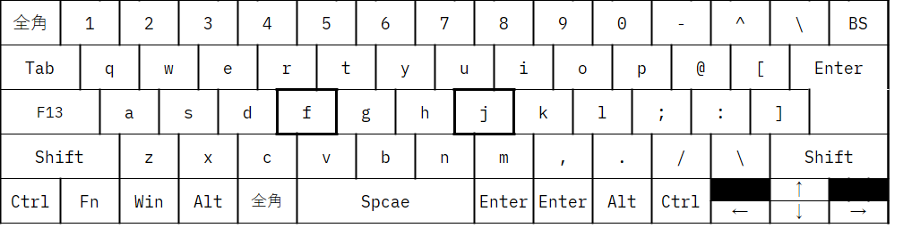
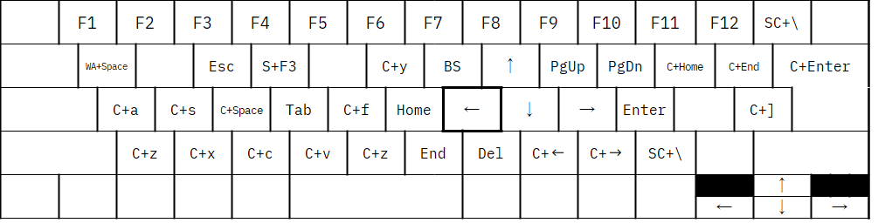
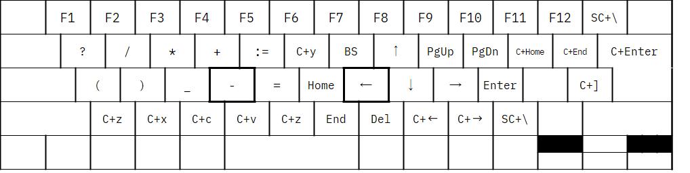
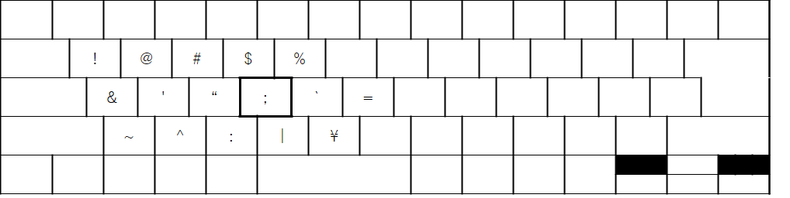
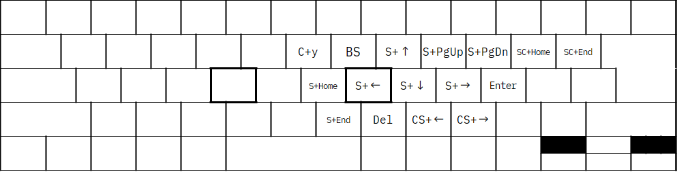
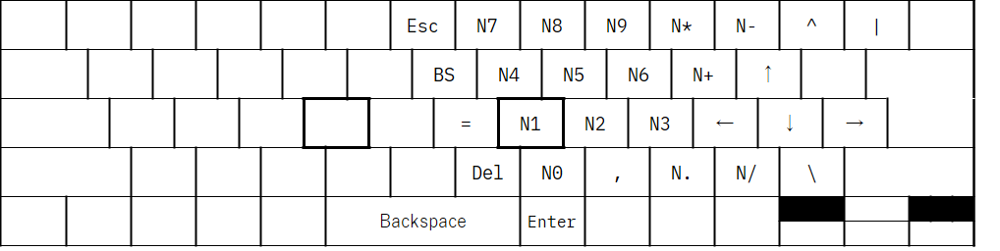
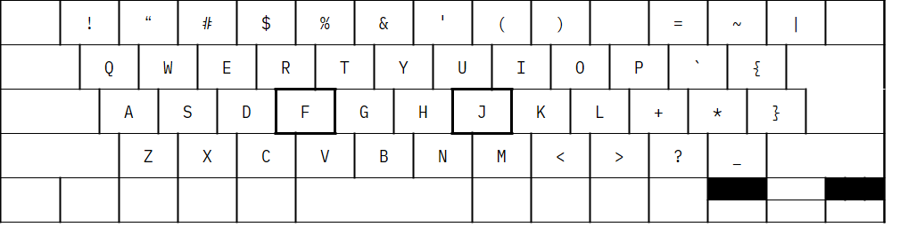

= Playgrounds

* キー入力の新機能を実験するためのAutoHotkey v2 用のキーカスタマイズスクリプトです。

== 緒言

* **主な機能**:
** 「Space」キーなどを修飾キー(モディファイアキー)化してレイヤー切り替えを実現
** 単押し（タップ）では通常の Space として動作し、他キーとの組み合わせでは修飾キー（レイヤー切り替え）として機能する。
** 短押し判定のしきい値（デフォルト200ms）などはスクリプト内で調整可能となる。
* **高いカスタマイズ性**:
** 各機能の有効/無効化や、詳細な設定変更を推奨する。
** 多機能かつ実験的な要素も含まれているため、自身の環境に合わせた「ベースサンプル」としての利用を想定している。
** Dvorak、Colemak、オリジナル配列など、多種多様なキー配列(キーレイアウト)に柔軟に対応可能。
* **日本語環境への最適化**:
** JIS配列キーボードでの利用を前提としていますが、キー数の少ない US キーボード等への応用も効果的。
** 「Caps Lock」や「ひらがな/カタカナ」キーの挙動を安定させるため、レジストリ等でスキャンコードを F13, F14 等に書き換えて運用している。なお、PowerToys等の設定変更ツールを使用しても挙動が安定するという話を聞いたが試してはいない。

* ShiftでCapsLock-Offできる環境以外の動作は不定（以下の設定を推奨）
* 現在のところ、広く使ってもらうというよりは、配列やキータイプに関する実験を行うための要素が強い

=== 用語
レイヤー::
キーに押下することで標準外の文字入力やコマンド発行がなされるキー配列

修飾キー::
ShiftやCtrlと同様に、他のキーの同時押し(コンビネーション)で特殊な動作が行われるキー +
修飾キーを押している間、レイヤーが切り替わる

== PlayGround.ahk
=== 概要
* **スペース・シフト**: スペースバーの長押しを通常の Shift キーと同じように扱える。
* **配列スイッチャー**: キー配列を動的に切り替え可能。大西配列や Colemak などへ瞬時に変更できる。
* **レイヤー機能**: 指定された修飾キー（[ ] で示されるキー）を押し下げている間、キーマップが対応するレイヤーに切り替わる。
* **ロールオーバー誤判定防止（バッファ付き同時押し判定）**: 修飾キーの押下から一定時間（`LayerHoldTh`、デフォルト200ms）以内の高速なロールオーバー入力時に、バッファ時間（`b_time` / `b_time2`、デフォルト50ms）と前後キーの離鍵順序を組み合わせて通常打鍵とレイヤー動作を正確に判別する。

=== このスクリプトの構造
  "Playgrounds.ahk" - 実行対象本体
  "PlaygroundsExp.ahk" - Playgrounds.ahkの先行機能実装版
  "Utils.ahk" - ユーティリティ関数集
  "Preset.ahk" - プリセットの設定関数
  "Handler.ahk" - 各種イベントのハンドラー

"Playgrounds.ahk"、"PlaygroundsExp.ahk"は排他で実行

=== Autohotkey有効時の標準状態

=== ナビゲートレイヤー [F13]
カーソル移動、編集操作、Fキーなど

(Enter誤爆対策)
IMEの確定をShift+Enterの割り当てることを推奨

=== 記号・数値レイヤー [無変換]
数字、演算記号など

=== 記号レイヤー1 [変換]
記号レイヤー

=== 記号レイヤー2 [F14]
その他の記号

=== 選択レイヤー [(F13 + Alt) or (F13 + 無変換)]
範囲選択を伴うカーソル移動など

=== １０キーレイヤー [Tab]
右手系テンキー

=== シフトレイヤー [Space]
通常のShiftキー動作に加え、カーソル移動などを割り当て

=== ファンクションレイヤー [変換 + F14]
F1〜F12キーなどの機能キー（L_FUNC）

=== 配列切り替え
キー配列を変更可能。

* [Win] + [F13] + [q] : Qwerty配列
* [Win] + [F13] + [o] : 大西配列 (Oonishi)
* [Win] + [F13] + [c] : Colemak配列

=== キーロガー (KeyLogger)
タイピングの統計（3キーシーケンス（トリグラム）の出現頻度と打鍵間隔）を記録します。
各配列の効率分析や、自身のタイピング傾向の把握に活用できます。

* **セキュリティ配慮**: パスワード等の記録を避けるため、**IME ON（日本語入力時）のみ**動作するように設計されています。
* **操作**: [Win] + [F13] + [.] で機能の ON/OFF を切り替え可能です。
* **データ保存**: 統計結果は `log.txt` に出力されます。

=== IME インジケーター (IME Indicator)
現在の IME 状態を視覚化します。キャレットやマウスカーソルに追従して小さなドットを表示し、日本語入力が ON の場合は赤、OFF の場合は緑で示します。なお、文字入力を独自制御するアプリケーションでは、正しいキャレット位置にドットを表示できない場合があります。

* **操作**: [Win] + [F13] + [,] または [F13] + [,] でインジケーターの表示モード（非表示 / キャレット右下にのみ表示 / マウスカーソルにのみ表示 / 双方表示）を切り替えます。

=== ロールオーバー誤判定防止（バッファ付き同時押し判定）
高速タイピング時のロールオーバーによって、修飾キー（[F13]、[Space]、ホームポジションキー等）を押し下げてからホールド判定しきい値（`LayerHoldTh`）に達する前に次のメインキーが押下された場合の誤爆を防ぐ機構です。

* **動作の仕組み**:
** 修飾キー押下からの経過時間 `t` が `LayerHoldTh` 以上の場合は、即座にレイヤー動作（同時押し）として成立させます。
** 経過時間 `t` が `LayerHoldTh - b_time` 未満の極短時間である場合は、高速ロールオーバーとみなして通常打鍵として処理します（Mode 6 および Mode 9 を除く）。
** `LayerHoldTh - b_time <= t < LayerHoldTh` のグレーゾーンでは判定を一時保留し、両キーの離鍵順序やホールド継続時間に応じて通常打鍵か同時押し動作かを確定させます。
* **多重発火の防止**:
** 同時押しが成立した修飾キーは内部的に処理済み状態へ遷移するため、離鍵時の単体キー誤爆や重複送信を防止します。

=== その他機能
* **サスペンド** : [Win] + [Alt] + [Enter] でスクリプトの一時停止
* **マウス速度制御**: [Win] + [F13] + [Up/Down] でシステムのマウスカーソル速度を変更
* **IME制御**:
** [F14] / [変換] で IME トグル
** [Shift] + [全角] で 英数
* **ヘルプ** : [F13] + [Win] + [h]で ヘルプを表示

== config.ini の設定とカスタムキー配列(カスタムレイアウト)仕様

`config.ini` を編集することで、キー配列や各種レイヤーのマッピングを動的にカスタマイズできます。
設定ファイルには共通設定を行う `[Settings]` セクションと、各キー配列定義セクション（`[1]`, `[2]`, `[3]` ...）が存在します。

=== 共通設定 (`[Settings]`)
[horizontal]
StartupLayout:: 起動時に適用するキー配列名（例: `Qwerty[Built-in]`, `Oonishi[Built-in]`, `FMIX13f-Kanade` など）。
HoldTh:: 通常キーの長押し（Mode 1 のシフト置換など）と判定するしきい値（ミリ秒、デフォルト: `300`）。
PreStrokeBuf:: 互換性保持用の予備パラメータ（ミリ秒、デフォルト: `30`）。
LayerHoldTh:: レイヤーキー長押し判定（レイヤー切り替え・同時押し）のしきい値（ミリ秒、デフォルト: `200`）。
b_time:: 同時押し（Mode 5, 7, 9）におけるロールオーバー判定のバッファ時間（ミリ秒、デフォルト: `50`）。
b_time2:: 同時押し（Mode 8）におけるロールオーバー判定のバッファ時間（ミリ秒、デフォルト: `50`）。
ImeIndicatorMode:: IMEインジケーターの表示モード（`0`: 非表示、`1`: キャレット右下にのみ表示、`2`: マウスカーソルにのみ表示、`3`: 双方表示、デフォルト: `3`）。
ImeIndicatorEnabled:: IMEインジケーターの表示 (`1`) / 非表示 (`0`)（`ImeIndicatorMode` 未指定時の後方互換用）。
LogEnabled:: キーロガーの有効化 (`1`) / 無効化 (`0`)。
MaxLog:: キーロガーの最大保存件数（デフォルト: `5000`）。
space, noconv, conv, tab, f13, f14:: 各修飾キーに対応する動的カスタムレイヤー定義のセクション名（例: `space = NAVI_CTRL`）。指定された場合、対応するキーを押している間のレイヤーに、指定セクション内のキーマッピングが動的に上書き・追加適用されます。

=== キー配列定義（バージョン 2 形式 `ver = 2`）
IME OFF時とIME ON時のキー定義セクションを分離し、より柔軟なモード指定や同時押しを設定できる高度な仕様です。

==== 1. 親セクション定義（`[2]` など）
対象のキー配列番号セクション（例: `[2]`）で、使用するバージョンや配列定義セクションを紐づけます。
[horizontal]
ver:: バージョン。`2` を指定します。ver1の利用は非推奨
Name:: キー配列の識別名（例: `FMIX13f-Kanade`）。
Layout:: IME OFF時の配列を定義したセクション名（例: `FMIX13`）。
LayoutIME:: IME ON時の配列を定義したセクション名（例: `Kanade`）。省略時は `Layout` セクションと同じ定義が使用されます。

==== 2. 配列定義セクション（`[FMIX13]` や `[Kanade]` など）
`Layout` および `LayoutIME` で指定した各セクション内で、具体的なキー配置や挙動を設定します。

===== A. モード指定
* *`Mode`*: このキー配列で使用する長押しキーの動作モードを指定します（デフォルト: `1`）。
** `Mode=0` (標準リマップモード): 長押し判定を行わず、キーを押した瞬間に即リマップキーを送信します。キーリピートが有効です。
** `Mode=1` (即時送信・長押しシフト置換モード): 押し下げ（Down時）に即座に通常キーを送信します。一定時間以上の長押し（`HoldTh`）に達した場合、送信済みの文字を Backspace で消去し、シフト版（または指定キー）を再送信して置換します。キーリピートは無効です。
** `Mode=2` (純粋修飾キーモード): 押し下げ・離し時の単体出力を完全に抑制し、純粋なレイヤー切り替え等の修飾キーとして機能します。キーリピートは無効です。
** `Mode=3` (後判定（離鍵送信）修飾キーモード): キーを押し下げた瞬間に修飾キー状態を保持し、キーを離した（Up時）に長押しされていなければ通常キーを送信します。長押しされた場合は何も送信せず修飾キー（レイヤー用）として機能します。キーリピートは無効です。
** `Mode=4` (前判定（即時送信）修飾キーモード): 押し下げ（Down時）に即座に通常キーを送信し、キーが押され続けている間は修飾キーとして機能します。キーリピートは無効です。
** `Mode=5` (タイミング判定同時押しモード - 即時入力なし): 修飾キー（A）がDownしてから経過時間 `t` としきい値 `LayerHoldTh`、およびバッファ時間 `b_time` に基づいて動作します。Down時にはキー送信を行わず、以下の条件で判定します。
*** *条件1* (t >= LayerHoldTh): 修飾キーの同時押しを即座に送信。
*** *条件2* (t < LayerHoldTh - b_time): AとBの通常キーをそれぞれ送信。
*** *条件3* (LayerHoldTh - b_time <= t < LayerHoldTh): 判定を保留し、どちらが先にUpされたか等の状況に応じて通常キーか同時押しキーかを確定します。
** `Mode=6` (即時入力・時間判定同時押しモード - ロールオーバー対策・BSなし): モード4のタイミング拡張版。AキーDown時に通常キーを即時送信し、他方のBキーが一定時間内に押された場合はタイミング判定を行います。同時押し確定時のBackspaceによる自動消去は行いません。キーリピートは無効です。
** `Mode=7` (タイミング制御同時押しモード - バッファ b_time 付き): モード4のタイミング拡張版（標準の同時押し優先）。AキーDown時に通常キーを即時送信し、しきい値 `LayerHoldTh` とバッファ時間 `b_time` に基づいて誤爆を防ぐタイミング判定を行います。
*** *条件1* (t >= LayerHoldTh): 修飾キーの同時押しを即座に送信。
*** *条件2* (t < LayerHoldTh - b_time): メインキーの通常キーを即座に送信（Down時確定）。
*** *条件3* (LayerHoldTh - b_time <= t < LayerHoldTh): 判定を一時保留し、その後の入力状況（離鍵順序やホールド継続）に応じて挙動を確定します。
** `Mode=8` (先行離鍵対応タイミング制御同時押しモード - バッファ b_time2 付き): モード7のさらなる拡張版。バッファ時間 `b_time2` を使用します。メインキー（B）が先に離された場合（先行離鍵）でも、同時押し（コンビネーション）として成立させます。
** `Mode=9` (先行送信・長押し置換同時押しモード - バッファ b_time 付き): モード7の拡張版。高速ロールオーバー領域（`t < LayerHoldTh - b_time`）でも一旦Bの通常キーを先行送信したうえで待機し、両キーともホールドのまま `LayerHoldTh` に達した場合は送信済み文字を Backspace で消去して同時押しアクションへ置換します。

===== B. 基本・状態別配列定義
JISキーボードの4段に対応する行ごとのスペース区切り文字列によって、全体のキー配列を定義します。

* *`L00` 〜 `L03`*: 通常配列 (Shift OFF)
* *`S00` 〜 `S03`*: Shift配列 (Shift ON)

各行に定義するキーの個数とQWERTY配列での対応位置は以下の通りです（計48キー）：
[cols="1,2,3"]
|===
|行識別子 |対応する段 (キー数) |デフォルトのQWERTYキー順

|`00`
|数字・記号段 (13キー)
|`1 2 3 4 5 6 7 8 9 0 - ^ \`

|`01`
|QWERTY段 (12キー)
|`q w e r t y u i o p @ [`

|`02`
|ASDF段 (12キー)
|`a s d f g h j k l ; : ]`

|`03`
|ZXCV段 (11キー)
|`z x c v b n m , . / \`
|===

===== C. 同時押し定義
同時押し定義をセクション内に追加し、連続打鍵数に応じたアクション（最大3段階）や、キーごとの判定しきい値・待機時間の個別微調整を行えます。キー指定は論理キー名（レイアウト適用後の文字・記号）で解決され、先頭に `P` を付けると物理QWERTYキー名で指定できます。

* *記述形式 1 (判定時間微調整あり)*: `m_[修飾キー]_[対象キー] = "mode[,hold_th][,b_time]",action1[,action2][,action3]`
** 例: `m_s_d = "8,250,75",myaction1,myaction2,myaction3`
** 動作モード `mode`、判定しきい値 `hold_th` (ms)、およびバッファ時間 `b_time` (ms) をダブルクォーテーションで囲んでカンマ区切りで記述し、その後に送信するアクションを最大3段階まで定義できます。
* *記述形式 2 (判定時間微調整なし)*: `m_[修飾キー]_[対象キー] = mode,action1[,action2][,action3]`
** 例: `m_r_p = 7,areru`
** モード `mode` とアクションを直接指定します。しきい値やバッファ時間が省略された場合は、それぞれ標準値（`LayerHoldTh` およびモード別の標準バッファ時間）が適用されます。
* *省略時デフォルト*: `action2`, `action3` は省略可能で、省略時は空文字 `""` が自動的に設定されます。
* *後方互換形式*: `m_[修飾キー]_[対象キー] = [出力文字列]`
** 例: `m_a_s = abc`
** 動作モードは自動的に `7` に設定され、アクション1: `abc`、アクション2・3: `""` として処理されます。
* ※ IME ON時/OFF時いずれのセクションでもプレフィクスは `m_` で統一します。

===== D. 個別キーのオーバーライド設定
行定義の上から、特定の物理キーに対してピンポイントでキーマップの上書き（単キー/ショートカット/特殊送出）が可能です。
キー名には、元のQWERTY配列での役割に応じた定義名を使用します。

* *個別キー記述名*: 例として `semicolon` (`;`), `colon` (`:`), `comma` (`,`), `noconv` (無変換), `conv` (変換) など。
* *自動パース（記述の簡略化）*: INIファイル上の値設定で、1文字の危険な記号・修飾記号（`+` や `*` など）を自動検知して安全な形式（ `{}` 囲み）にエスケープする機能を備えているため、`semicolon = :` や `s_semicolon = +` のように素のままで記述できます。
* *個別キー用の状態プレフィックス*:
** プレフィックスなし: 通常時
** `s_`: Shift押下時

==== 3. 記述例
[source,ini]
----
[2]
ver = 2
Name = FMIX13f-Kanade
Layout = FMIX13
LayoutIME = Kanade

[FMIX13]
Mode = 1
L00 = 1 2 3 4 5 6 7 8 9 0 - ^ \
L01 = q w r l k y f u p ; @ [
L02 = a s d t g h n e i o : ]
L03 = z x c v b j m , . / \

[Kanade]
Mode = 4
L00 = 1 2 3 4 5 6 7  8 9  0 - ^ \
L01 = q w r p l f yu u yo - @ [
L02 = k s t n h ; a  i e  o : ]
L03 = g z d m b j m  , .  / \

S00 = 1 2 3 4 5 6 7   8  9  0 - ^ \
S01 = q w r p l f yu  u  yo - @ [
S02 = k s t n h ; ya  xi xe o : ]
S03 = [ ] d m b j ltu ,  .  / \

e=r ;
s_e=R ;

; 同時押し定義 (r + p で areru を出力)
m_r_p = areru
----

=== 3. レイヤー配列構造と INI 設定仕様

本スクリプトでは、内部的にレイヤーID（1〜8、動的9+）を添字とする配列構造によって各レイヤーと修飾キーの紐付けを一元管理しています。
新仕様では、修飾キーと物理キーの判定ロジックをシステム内部の「固定マッピング」として管理し、INIファイル上では修飾キーID（`M1`〜`M14` 等）のみを扱うことで、冗長な記述を排除しつつ配列構造を完全かつ双方向に保存・復元できます。

==== A. 修飾キーID (`mod_key_id`) と固定マッピング仕様
修飾キーIDと物理キー・複合条件の対応関係は以下の通り固定されており、INIファイル側でキー名称（`space` や `sc079` 等）を冗長に定義する必要はありません。

[cols="1,2,3,4"]
|===
|mod_key_id |定数名 |対応する物理修飾キー / 判定条件 |内部判定動作
|`1`|`M1`|F13 (単独)|F13押下中（Alt・無変換なし）
|`2`|`M2`|無変換 (単独)|無変換押下中（F13・Alt・Tab・Spaceなし）
|`3`|`M3`|変換 (単独)|変換押下中（F14なし）
|`4`|`M4`|F14 (単独)|F14押下中（変換なし）
|`5`|`M5`|F13 + Alt|F13とAltの同時押し
|`6`|`M6`|F13 + 無変換|F13と無変換の同時押し
|`7`|`M7`|Tab (単独)|Tab押下中（Alt・無変換・Spaceなし）
|`8`|`M8`|Space (Space-Shift)|Space押下中（F13・無変換・Tabなし）
|`9`|`M9`|変換 + F14|変換とF14の同時押し
|`10`|`M10`|F13 + Space|F13とSpaceの同時押し
|`11`|`M11`|無変換 + Space|無変換とSpaceの同時押し
|`12`|`M12`|Tab + Alt|TabとAltの同時押し
|`13`|`M13`|Tab + 無変換|Tabと無変換の同時押し
|`14`|`M14`|Tab + Space|TabとSpaceの同時押し
|`15`〜|`M15`〜|動的コンビネーション登録キー|単体登録キー押下中
|===

==== B. レイヤー配列バインディング定義 (`[LayerBinding]` セクション)
`[LayerBinding]` セクションは、内部のレイヤー配列構造を直接シリアライズ/デシリアライズする新仕様のセクションです。

* **キー名**: レイヤー識別名（`NAVI_CTRL`, `SYMBOL_NUM`, `SYMBOL1`, `SYMBOL2`, `SELECT`, `NUMPAD`, `SHIFT`, `FUNC`、または任意のカスタムレイヤー名、`1`〜`8` 等の数値レイヤーID）
* **値フォーマット**:
** `M1` 〜 `M14`（または `1` 〜 `14` の整数、またはカンマ区切り `M5, M6`）: 割り当てる修飾キーIDを指定。
** `0` / `none` / 空文字: そのレイヤーを未割り当て・無効化。
** 不正な修飾キーIDが指定された場合は、エラーで停止せず安全に標準の初期値へフォールバックします。

==== C. 各レイヤー定義セクション (`[<LayerName>]`)
各レイヤーの具体的なキーマップを定義するセクションです。

* **グリッド配列定義 (`L00` 〜 `L03`)**: JIS 4段の一括キー配列定義。
* **個別キーオーバーライド**: `<物理キー名> = <送信アクション>` 形式でピンポイントに上書き。
** **多段階アクション**: `|`（パイプ）区切りで `アクション1|アクション2|アクション3` を指定可能。修飾キーを押したままの連続打鍵回数（1回目、2回目、3回目以降）に応じて出力を切り替えます。

==== D. 設定読み込み (Load) 時の優先順位と後方互換性
INIファイルのロード時（起動時またはレイアウト切り替え時）は、以下の優先順位に従って安全にレイヤー配列を復元します：

1. **`[LayerBinding]` セクションの定義 (最優先)**: 指定されたレイヤー名/IDと修飾キーIDのバインドを適用。
2. **レガシー `[Settings]` セクション (後方互換サポート)**: `space = NAVI_CTRL` や `NAVI_CTRL = M1` などの旧記法から修飾キーIDを解決して適用。
3. **システム既定の初期配列 (`[1, 2, 3, 4, [5, 6], 7, 8, 9]`)**: 上記のいずれにも該当しない未設定レイヤーに適用。

==== E. 設定記述例
[source,ini]
----
[Settings]
StartupLayout = TF2_1-Minato[Built-in]
HoldTh = 300
LayerHoldTh = 200

; ============================================================================
; レイヤー配列バインディング (layer_id -> mod_key_id)
; ============================================================================
[LayerBinding]
NAVI_CTRL = M1
SYMBOL_NUM = M2
SYMBOL1 = M3
SYMBOL2 = M4
SELECT = M5, M6
NUMPAD = M7
SHIFT = M8
FUNC = M9
; カスタムレイヤーを無変換 (M2) にバインドする例
SHORTCUT_CTRL = M2

; ============================================================================
; 各レイヤーの個別定義
; ============================================================================
[NAVI_CTRL]
h = {Blind}{Left}
j = {Blind}{Down}|{Blind}{PageDown}
k = {Blind}{Up}|{Blind}{PageUp}
l = {Blind}{Right}
u = {Blind}{Home}
o = {Blind}{End}
i = {Blind}{Backspace}

[SELECT]
h = +{Home}
j = +{Left}
k = +{Down}
l = +{Right}
u = {Backspace}

[SHORTCUT_CTRL]
a = ^a
s = ^s
c = ^c
v = ^v
----

== 設定エディタについて
`ui` フォルダ内には、ブラウザで動作するビジュアル設定エディタ（`ui/index.html`）が同梱されています。複雑な `config.ini` の記述を手動で行うことなく、グラフィカルな画面で直感的にカスタマイズや管理を行うことができます。なお設定エディタはβ版です。

=== 起動方法
1. `ui/index.html` をブラウザ（Chrome、Edgeなどの Chromium系ブラウザ推奨）で開きます。
2. 画面右上の「ファイルを開く」ボタンから、本リポジトリの `config.ini` を選択してロードします。
* ※ Chromium系ブラウザでは、File System Access API や IndexedDB により、一度許可したファイルへの直接上書き保存（オートロード/ダイレクトセーブ）が可能です。

=== 各画面・パネルの説明

==== 1. 一般設定 (Settings)
起動時に適用されるデフォルトキー配列（`StartupLayout`）や、各種判定のしきい値・遊び時間などを設定します。
* **起動時レイアウト (StartupLayout)**: 起動時に自動適用されるキー配列スロット。
* **通常キー長押ししきい値 (HoldTh)** / **レイヤーキー長押ししきい値 (LayerHoldTh)**: 長押し（Tap-Hold）判定用のミリ秒。
* **同時押し待機遊び時間 (b_time / b_time2)**: Mode 5, 7, 8, 9 で使用される、同時押しのタイミング誤爆防止用のバッファ時間（ミリ秒）。
* **IMEインジケーター表示モード / キーロガー有効**: キャレット・マウス追従インジケーターの表示モードや打鍵統計の出力を設定します。

==== 2. 動的レイヤー (Dynamic Layers)
`space` や `noconv` などの親キー(修飾キー)長押し時に、どのカスタムレイヤー（`NAVI_CTRL` や `SHORTCUT_CTRL` など）を動的に適用するかを一覧で紐付けます。

==== 3. キー配列スロット(レイアウトスロット) (Layout Slots)
AHKスクリプトから切り替え可能な「スロット（1, 2, ...）」を定義します。
* スロット名、**IME OFF 時のキー配列定義**（英数用キー配列）、**IME ON 時のキー配列定義**（かな入力用キー配列）を個別に指定して紐付けることができます。

==== 4. キー配列定義 (Key Layouts)
物理キー配列に対応したメインのキーマップ編集エリアです。
* **キー配列プレビュー**: 物理キーボードを模したビジュアル画面で、キーをクリックしてマップ先文字や `{Left}` などの特殊送信コマンドを入力・編集できます。「Shiftキー押下状態」のチェックを入れることで、Shift時の配列（`S00`〜`S03`）も個別に編集可能です。

* **同時押し定義 [Mode 4〜9用]**:
  特定の2キーの同時押し（`m_x_y`）に対するアクションを登録します。以下の項目を設定できます。
  ** **モード設定**: `Mode 9`、`Mode 8` (タイミング制御・B先行離鍵)、`Mode 7`、`Mode 6`、`Mode 5`、`Mode 4` から選択。
  ** **しきい値・遊び時間**: 個別の `hold_th`、`b_time` を指定可能（省略時はデフォルト値）。
  ** **マルチアクション**: 通常（1打鍵目）、2打鍵目連続、3打鍵目連続のそれぞれに送信するアクション（`action1`, `action2`, `action3`）を記述できます。
* **個別オーバーライド**: 特定の物理キーのみ、行定義（`L00`〜`L03`）から外れて個別に動作を上書きする定義を指定します。
* **インポート/エクスポート**: 定義したキー配列単体を `.klt` ファイルとして保存・読み込みできます。

==== 5. 修飾キーレイヤー(モディファイアレイヤー)設定 (Modifier Layers)
親キー長押し時に有効になる、修飾キーレイヤー（`[NAVI_CTRL]` など）専用のキーマップをビジュアル編集します。こちらもキーをクリックするだけで簡単にマッピングを追加できます。

==== 6. テキストデータの直接編集
`config.ini` の生のテキストデータを直接編集できます。「変更をビジュアル表示に適用」ボタンを押すことで、テキスト編集内容がビジュアル画面に反映されます。

=== 設定の保存方法
* UI上での一時的な編集内容は、画面右上の **「保存 (Save)」** ボタンをクリックすることで `config.ini` ファイルに書き込まれます。
* ブラウザのセキュリティ制限等で直接上書き保存（PUT / File System Access API）が行えない場合は、自動的に `config.ini` がダウンロードされますので、既存のファイルを上書き（置き換え）してください。